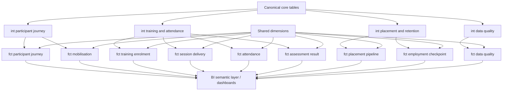

# Voice of Needy IDS dashboard and reporting data model

**Status:** Proposed final/mart layer. Dashboard questions and indicator definitions require business approval.

The dashboard must read prepared dimensions and fact tables. It should not perform identity matching, stage reconstruction, deduplication, date parsing or business-rule transformations inside the BI tool.

## 1. Dashboard data flow

## 2. Shared dimensions

### `mart.dim_date`

**Grain:** one row per calendar date.

Core columns:

- `date_key`
- `calendar_date`
- day, week, month, quarter and calendar year
- financial month, quarter and financial year
- month start/end
- reporting-period labels

### `mart.dim_programme_project`

**Grain:** one row per approved programme/project combination and validity period.

Core columns:

- programme/project surrogate key
- programme and project IDs/codes/names
- donor ID/name
- project start/end
- project status
- reporting period

### `mart.dim_location_site`

**Grain:** one row per reporting location/training-site combination and validity period.

Core columns:

- location/site surrogate key
- state, district, taluk/block, city/village
- training site code/name/type
- canonical centre/reporting group
- active period

### `mart.dim_batch`

**Grain:** one row per training batch.

Core columns:

- batch surrogate key
- batch ID/code/name
- programme/project key
- location/site key
- planned and actual dates
- target size
- batch status
- financial year

### `mart.dim_participant_reporting`

**Grain:** one row per participant reporting profile version.

Contains only approved reporting attributes:

- participant surrogate key
- protected participant ID
- gender category
- age/age band at reporting reference
- disability category and approved grouping
- education category
- district/location grouping
- profile validity period

Names, phones, addresses, identity-document values and unnecessary free text are excluded.

### `mart.dim_employer`

**Grain:** one row per employer reporting profile/version.

Core columns:

- employer surrogate key
- employer ID/code
- employer name
- sector
- location grouping
- verification status
- validity period

## 3. Fact/final tables

### `mart.fct_participant_journey`

**Grain:** one participant × journey stage × episode.

Purpose: participant funnel and stage conversion without assuming a single linear journey.

Keys/dimensions:

- participant key
- programme/project key
- location/site key
- stage code
- episode ID
- first/last stage date
- current/closed flag
- source authority/evidence state

Measures/flags:

- stage count
- reached stage flag
- days from previous stage
- unresolved/unknown flag

Supported questions:

- How many people were sourced, contacted, registered, enrolled, trained, placed and retained?
- What is the conversion between stages?
- Where are people dropping out or remaining unresolved?
- How do results vary by year, project, location and approved demographic groups?

### `mart.fct_mobilisation_interaction`

**Grain:** one observed mobilisation interaction.

Keys/dimensions:

- interaction ID
- participant/lead key
- assigned mobiliser key, where permitted
- date key
- programme/project/location
- interaction type
- outcome
- source channel
- next-action status

Measures:

- interaction count
- connected flag
- interested flag
- follow-up due/overdue flag
- attempts-to-registration

Supported questions:

- Calls/visits by period and mobiliser
- Connection and interest rates
- Follow-up workload
- Source-channel conversion

### `mart.fct_training_enrolment`

**Grain:** one enrolment.

Keys/dimensions:

- enrolment ID
- participant key
- batch key
- programme/project/location
- enrolment and exit date keys
- enrolment/completion/exit status
- source/evidence state

Measures:

- enrolment count
- completion flag
- dropout/discontinued flag
- duration days
- scheduled sessions
- attended sessions
- attendance percentage
- assessment availability flags

Supported questions:

- Enrolled and completed participants
- Completion and dropout by batch/project/site
- Repeat-enrolment count
- Attendance-completion relationship

### `mart.fct_session_delivery`

**Grain:** one batch session.

Keys/dimensions:

- batch session ID
- batch/programme/project/location
- session definition/module
- planned and actual date keys
- trainer key where permitted
- delivery status

Measures:

- planned session count
- completed/partial/postponed/cancelled flags
- planned and actual duration
- enrolled participants
- present participants
- attendance percentage

Supported questions:

- Planned versus completed sessions
- Delivery timeliness
- Session attendance
- Module coverage by batch

### `mart.fct_attendance`

**Grain:** one enrolment × batch session.

Keys/dimensions:

- attendance ID
- participant key
- enrolment ID
- batch/session keys
- date/programme/project/location
- attendance status
- verification/evidence state

Measures:

- scheduled flag
- present flag
- absent flag
- excused flag
- verified flag

Supported questions:

- Daily/session attendance rate
- Participants below approved thresholds
- Batch and module attendance trends
- Historical coverage and verification status

### `mart.fct_assessment_result`

**Grain:** one enrolment × assessment event × domain/measure.

Keys/dimensions:

- assessment result ID
- participant/enrolment/batch
- assessment instrument/version
- stage and domain/measure
- date/programme/project/location
- evidence status

Measures:

- raw score
- maximum score
- percentage score
- valid comparison flag
- change from approved prior stage

Supported questions:

- Assessment availability
- Baseline-to-endline or midline-to-final change only for comparable instruments
- Performance by domain and batch
- Missing/unverified assessment coverage

Kredo, counselling observations and future formal assessments remain separate unless an approved scoring map establishes comparability.

### `mart.fct_placement_pipeline`

**Preferred grain:** one placement attempt × stage event. If management only needs attempt-level reporting, an additional current-state view can expose one row per attempt.

Keys/dimensions:

- placement attempt and stage-event IDs
- participant/enrolment
- employer/opportunity
- programme/project/location
- stage/outcome
- event date
- evidence status

Measures:

- referral/interview/selection/offer/joining flags
- days from referral to stage
- verified stage flag

Supported questions:

- Candidate pipeline by employer and role
- Referral-to-interview, selection, offer and joining conversion
- Time to placement
- Reasons for rejection/withdrawal where approved

### `mart.fct_employment_checkpoint`

**Grain:** one employment episode × follow-up checkpoint.

Keys/dimensions:

- employment ID
- participant/employer/opportunity
- programme/project/location
- checkpoint type: 3, 6, 12 month or approved alternative
- due and completion date keys
- checkpoint status
- observed employment status
- evidence state

Measures:

- checkpoint due/completed/overdue flags
- retained flag
- job changed flag
- left flag
- support-needed flag
- days overdue
- verified compensation where approved

Supported questions:

- Follow-up completion
- Retention at each checkpoint
- Employment exits and job changes
- Support workload

### `mart.fct_employer_engagement`

**Grain:** one employer × reporting period.

Dimensions:

- employer
- period
- sector/location
- programme/project
- verification state

Measures:

- opportunities
- openings
- candidates referred
- interviewed
- selected
- offered
- joined
- retained
- active employer flag

### `mart.fct_data_quality`

**Grain:** one issue × reporting snapshot/status transition.

Dimensions:

- domain/table
- issue type
- severity
- owner/team
- source asset/authority
- detected/resolved dates
- issue status

Measures:

- issue count
- open/overdue/resolved flags
- age in days
- affected record count

## 4. Executive monthly snapshot

### `mart.snapshot_executive_monthly`

**Grain:** one month × programme × project × location/site.

This snapshot freezes reviewed headline figures after sign-off. It should include definition/version metadata.

Candidate measures:

- sourced people
- people contacted
- registered
- enrolled
- active training
- completed
- discontinued
- sessions planned/completed
- attendance rate
- assessment coverage
- placement attempts
- offers
- verified joinings
- 3/6/12-month retention
- open data-quality issues
- unresolved identities

This table is not the source of operational truth. It provides stable previously reported figures while source corrections continue.

## 5. Dashboard pages and table mapping

| Dashboard page | Primary table(s) | Required filters |
| --- | --- | --- |
| Executive overview | participant journey, training enrolment, placement pipeline, employment checkpoint, monthly snapshot | FY, programme, project/donor, location/site, batch |
| Sourcing and mobilisation | participant journey, mobilisation interaction | period, source channel, district, project, mobiliser |
| Registration and training | training enrolment, batch dimension | FY, project, site, batch, status |
| Session delivery | session delivery | batch, session/module, trainer, delivery status, date |
| Attendance | attendance, training enrolment | batch, date, participant group, verification state |
| Assessments | assessment result | instrument, stage, domain, batch, evidence state |
| Placement pipeline | placement pipeline | employer, role, stage, date, project, location |
| Employment and retention | employment checkpoint | employer, checkpoint, due status, retention state |
| Employer engagement | employer engagement | employer, sector, location, period |
| Data quality | data-quality fact | domain, issue type, severity, owner, status |

## 6. Metric definitions requiring approval

| Metric | Proposed definition |
| --- | --- |
| Sourced person | Distinct safely resolved participant or unresolved lead episode received from a valid source |
| Contacted | At least one observed interaction with a connected/outcome value approved as contact |
| Registered | Registration reaches approved submitted/verified state |
| Enrolled | Active enrolment linked to a valid batch |
| Training completed | Approved completion decision, not inferred solely from end date |
| Placed | Recommended: verified joining/employment episode, not selection or offer |
| Retained at checkpoint | Employment active or approved equivalent at completed checkpoint |
| Attendance rate | Present sessions divided by sessions scheduled for the enrolment; treatment of excused absence requires approval |
| Session completion rate | Completed sessions divided by planned/scheduled sessions under approved status rules |
| Placement conversion | Verified joinings divided by approved pipeline denominator |
| Follow-up completion | Completed observed follow-ups divided by due checkpoints |
| Data completeness | Required present values divided by applicable required fields, separated for historical and future data |

## 7. Dashboard transformation rule

The BI layer may:

- filter;
- group;
- sum/count approved fact measures;
- calculate simple display percentages from supplied numerators/denominators;
- display drill-downs allowed by access policy.

The BI layer must not:

- merge participant identities;
- deduplicate source rows;
- parse or repair dates;
- map raw statuses;
- decide current participant stage;
- infer training completion;
- infer placement from employer presence;
- compare incompatible assessment instruments;
- build source authority rules;
- calculate overdue follow-ups from unapproved dates.

## 8. Data quality and refresh indicators

Every fact table should expose:

- `data_as_of`
- `pipeline_run_id`
- `definition_version`
- `source_coverage_status`
- `verification_status`
- `is_historical_incomplete`, where appropriate

Dashboards display an as-of date and data-quality warning when coverage is materially incomplete.

## 9. Cardinality review checklist

A destination table is accepted only when:

1. Its name reflects its grain.
2. Its grain is written in one sentence.
3. Its key is unique at that grain.
4. It contains all approved dashboard filter columns or safe dimension keys.
5. All displayed metrics can be generated without hidden transformation.
6. Same-grain tables are combined when doing so remains clear and secure.
7. Person-level and aggregate measures are not mixed incorrectly.
8. Every count reconciles to core data and an approved definition.
9. Sensitive attributes are excluded or access-controlled.
10. Historical incompleteness is visible rather than hidden.

## 10. Next dashboard-design step

The frontend/dashboard owner should provide the proposed pages, charts, filters and management questions. Each chart will then be mapped to one fact table, its grain, dimensions, numerator, denominator and approved definition before physical implementation.
