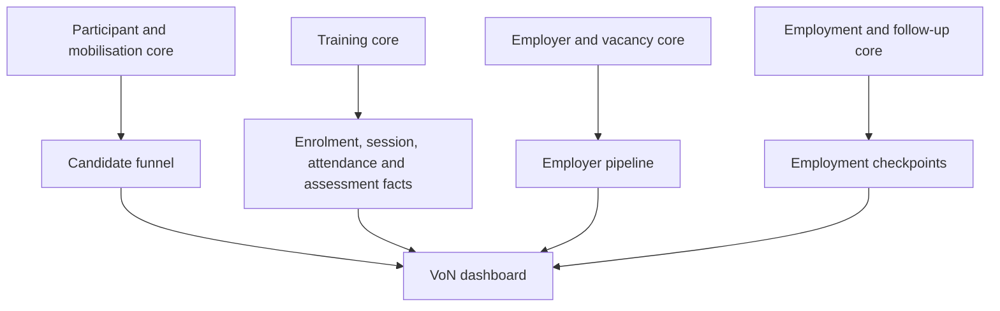

# Voice of Needy IDS dashboard data model

**Status:** Proposed mart layer derived from the 13 key questions. Measures remain subject to business-definition approval.

## Principle

Dashboards do not join raw spreadsheets or infer identities. They read prepared, tested facts and conformed dimensions built from the canonical core model.

## Conformed dimensions

| Dimension | Grain | Key attributes |
|---|---|---|
| `mart.dim_date` | One calendar date | Month, quarter, financial year, reporting period |
| `mart.dim_participant_reporting` | One pseudonymous participant | Reporting key, approved demographic/disability categories; no direct identifiers |
| `mart.dim_delivery_context` | One batch/project/centre combination | Batch code, programme, donor, centre, district, planned intake, dates |
| `mart.dim_opportunity` | One employer/vacancy | Employer, sector, role, work location, accessibility and vacancy status |

## Facts

| Fact | Grain | Questions supported |
|---|---|---|
| `mart.fct_candidate_funnel` | One mobilisation case | KQ01, KQ13 |
| `mart.fct_enrolment_outcome` | One enrolment | KQ02, KQ06, KQ07, KQ08, KQ13 |
| `mart.fct_session_delivery` | One planned batch session | KQ03, KQ13 |
| `mart.fct_attendance` | One enrolment-session | KQ06, KQ13 |
| `mart.fct_assessment_result` | One enrolment-assessment-point-domain | KQ05, KQ09, KQ13 |
| `mart.fct_employer_pipeline` | One candidate-vacancy match | KQ04, KQ08, KQ10, KQ13 |
| `mart.fct_employment_checkpoint` | One employment episode/checkpoint | KQ08, KQ10, KQ11, KQ12, KQ13 |

## Indicator definitions requiring approval

| Indicator | Proposed numerator | Proposed denominator | Important exclusions/notes |
|---|---|---|---|
| Mobilisation-to-enrolment conversion | Distinct cases linked to an enrolled participant/batch | Eligible, deduplicated mobilisation cases | Define eligibility and reporting window |
| Enrolment achievement | Enrolments | Planned batch intake | Show count and percentage; retain over-target results |
| Session delivery | Delivered planned sessions | Planned sessions due by report date | Rescheduled and cancelled shown separately |
| Assessment completion | Enrolments with valid assessment at point | Eligible enrolments at point | Baseline/midline/endline separately; missing reason required |
| Attendance rate | Present-equivalent marks | Required session opportunities | Decide late/approved leave treatment |
| 45-day completion | Eligible enrolments meeting approved completion rule | Eligible enrolments | Rule must specify attendance and exit conditions |
| Readiness complete | Latest review has profile, documents, resume and interview flags complete | Placement-eligible enrolments | Evidence verification rule required |
| Placement rate from enrolled | Verified joiners | Enrolments | Offer is not joining |
| Placement rate from completers | Verified joiners | Completers | Same cohort window required |
| Median completion-to-joining | Median days from completion to verified join date | Joiners with both dates | Negative/invalid intervals rejected |
| Retention at 12/24 months | Verified employed at checkpoint | Employment episodes due for checkpoint | Unreachable and unverified reported separately, not silently counted retained |
| Income change | Verified checkpoint income minus verified joining income | Episodes with comparable verified amounts | Currency, periodicity and missingness must be controlled |

## Key-question coverage

| KQ | Core source | Mart output |
|---|---|---|
| KQ01 | Mobilisation cases/interactions, enrolments | Candidate funnel |
| KQ02 | Batches, enrolments | Enrolment outcome |
| KQ03 | Sessions | Session delivery |
| KQ04 | Employers, vacancies, vacancy matches | Employer pipeline |
| KQ05 | Assessment events/results | Assessment result |
| KQ06 | Enrolments, attendance | Enrolment outcome + attendance |
| KQ07 | Readiness reviews | Enrolment outcome |
| KQ08 | Enrolments, vacancy matches, employments | Employer pipeline + employment checkpoint |
| KQ09 | Assessment events/results/rubrics | Assessment result |
| KQ10 | Support profiles, vacancies, matches, employments | Employer pipeline + employment checkpoint |
| KQ11 | Employments, employment follow-ups | Employment checkpoint |
| KQ12 | Employments, employment follow-ups | Employment checkpoint |
| KQ13 | All operational domains + delivery context | All facts by centre/batch/project/donor |

## Data-quality flags exposed to analysts

Each fact includes, where applicable: `is_verified`, `source_completeness_status`, `identity_resolution_status`, `data_quality_issue_count`, `is_late_record`, and `mart_refreshed_at`. Dashboard filters must not hide unresolved/unverified records by default; they should be visible as quality categories.
