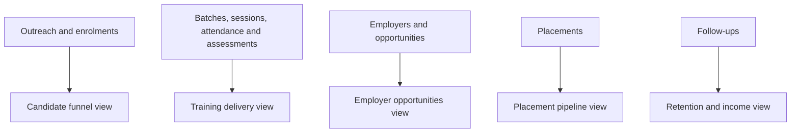

# Voice of Needy IDS dashboard model

**Version:** 3 — view-based reporting model

The reduced architecture does not create physical fact/dimension tables in release 1. The dashboard reads five documented SQL views built from the 12 core tables.

| View | Grain | Key questions |
|---|---|---|
| `reporting.vw_candidate_funnel` | One outreach record, with linked enrolment where available | KQ01, KQ02, KQ13 |
| `reporting.vw_training_delivery` | One enrolment-session | KQ03, KQ05, KQ06, KQ07, KQ09, KQ13 |
| `reporting.vw_employer_opportunities` | One job opportunity | KQ04, KQ13 |
| `reporting.vw_placement_pipeline` | One placement attempt | KQ04, KQ08, KQ10, KQ13 |
| `reporting.vw_retention_income` | One placement-follow-up checkpoint | KQ11, KQ12, KQ13 |

## Proposed KPI definitions requiring approval

| KPI | Numerator | Denominator/condition |
|---|---|---|
| Mobilisation-to-enrolment conversion | Eligible outreach records linked to enrolment | Deduplicated eligible outreach records in reporting window |
| Intake achievement | Enrolments | Planned batch intake |
| Session delivery | Delivered planned sessions due | Planned sessions due |
| Assessment coverage | Eligible enrolments with complete assessment | Eligible enrolments by point |
| Attendance rate | Approved present-equivalent marks | Required delivered-session opportunities |
| Completion | Enrolments satisfying approved completion rule | Eligible enrolments |
| Readiness | Latest enrolment readiness flags all complete | Placement-eligible enrolments |
| Placement rate | Verified joiners | Enrolments or completers, shown separately |
| Retention | Verified employed at due checkpoint | Placements due for checkpoint |
| Income change | Verified follow-up income minus verified joining income | Comparable verified income records |

Views expose data-quality and verification statuses rather than silently excluding unresolved records.
