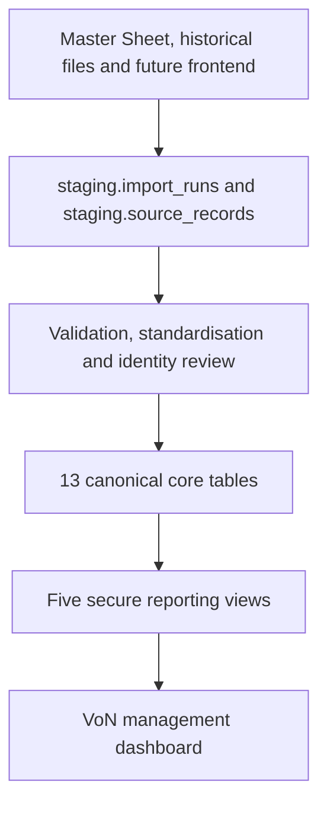

# Voice of Needy IDS data architecture

**Version:** 4 proposal

| Layer | Physical objects | Responsibility |
|---|---|---|
| Staging | `import_runs`, `source_records` | Immutable source-row evidence, typing, validation, identity review, disposition and reconciliation |
| Canonical core | 13 tables | Authoritative participant, programme delivery and employment pathway records |
| Audit | `change_log` | Material change history |
| Security | `user_access` | Role and optional project/centre scope |
| Reporting | Five SQL views | Dashboard-ready, read-only and privacy-controlled outputs |

## Migration sequence

`Extract → register import → preserve source row → standardise → validate → resolve identity → review exceptions → upsert core → reconcile → refresh views`

Migration reruns use source keys/checksums and stable target IDs. Unresolved or rejected rows remain in `staging.source_records`; they are never silently discarded or forced into a participant.

## Frontend boundary

- The frontend writes only through approved core operations.
- Raw/staging, audit and reporting views are not directly editable.
- New participants receive stable UUID and VoN participant codes.
- Attendance is an idempotent enrolment-session upsert.
- Placement attempts progress from mapping to joining without duplicating participant identity.
- Follow-up attempts are appended; earlier checkpoints are not overwritten.

No Supabase, production migration or Vercel change is included at this checkpoint.
