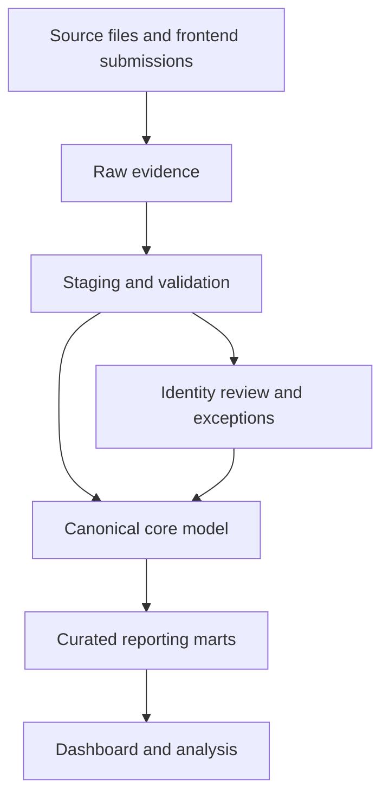

# Voice of Needy IDS data architecture

**Status:** Version 2 proposal aligned to the VoN key questions. GitHub documentation only; no Supabase or production changes.

## Architecture objective

Preserve original evidence, standardise and reconcile it once, operate from a small canonical model, and serve dashboards from prepared facts. The same core structure must accept both historical imports and future frontend submissions.

## Layer responsibilities

| Layer | Writes | Reads | Rules |
|---|---|---|---|
| Raw | Controlled import process | Migration team only | Immutable; preserve file, sheet, row, import time and checksum |
| Staging | Transformation pipeline | Profiling and reconciliation | Typed copies, standardised values, validation flags; never presented as authoritative |
| Core | Approved migration and frontend operations | Frontend, secure APIs, mart builder | Stable IDs, constraints, referential integrity, RLS and audit |
| Audit | Import pipeline and database triggers/functions | Data stewards and reviewers | Provenance, identity decisions, exceptions and changes |
| Mart | Reviewed transformation jobs/views | Dashboards and analysts | One documented grain per fact; no PII; reproducible from core |

## Core domains

| Domain | Tables |
|---|---|
| Reference | `reference_values`, `projects`, `locations`, `assessment_rubrics` |
| Participant | `participants`, `participant_identifiers`, `participant_contacts`, `participant_support_profiles` |
| Mobilisation | `mobilisation_cases`, `mobilisation_interactions` |
| Training | `batches`, `enrolments`, `sessions`, `attendance`, `assessment_events`, `assessment_results`, `readiness_reviews` |
| Placement | `employers`, `vacancies`, `candidate_vacancy_matches`, `employments`, `employment_followups` |
| People/access | `staff`, `user_roles` |

## Migration and audit objects

| Table | Purpose |
|---|---|
| `audit.import_runs` | One execution of one source import, with counts and result |
| `audit.source_records` | Immutable source locator, payload/hash and target mapping for every source row |
| `audit.identity_reviews` | Confirmed/probable/unmatched/conflicting identity decisions and evidence |
| `audit.data_quality_issues` | Field/record issue, severity, owner, resolution and disposition |
| `audit.change_log` | Material changes to protected/core records, actor and timestamp |

Unmatched records stay in staging/audit; they are not deleted and are not forced into a participant.

## Data movement

1. Register an import run and source asset.
2. Read each source row without altering the original file.
3. Store a source record locator and checksum.
4. Standardise types and controlled values in staging.
5. Validate required fields and relationships.
6. Resolve identity using verified identifiers and corroborating evidence.
7. Route uncertain matches to review.
8. Upsert core records using source keys and stable IDs.
9. Reconcile source, staged, loaded, rejected and unresolved counts.
10. Rebuild or refresh mart views and re-run KPI checks.

## Identity resolution

Automatic matching is permitted only for an exact, verified identifier configured as unique. Exact phone matching is evidence, not always proof, because phones may be shared. Name similarity never creates an automatic merge.

| Match class | Automated action |
|---|---|
| Confirmed | Link or upsert, with provenance |
| Probable | Hold for analyst review |
| Unmatched | Create unresolved prospect/source record; do not fabricate participant data |
| Conflicting | Block load to affected core entity and log issue |

## Frontend boundary

- The frontend never writes to raw, staging, audit or mart tables.
- Direct table writes should be limited to simple, policy-protected records; multi-table workflows use database functions/API endpoints.
- Participant creation returns the immutable participant ID.
- Enrolment requires an existing participant and batch.
- Attendance accepts one batch/session roster submission and performs idempotent upserts.
- Employment requires verified joining; an offer alone remains a vacancy-match stage.
- Breaking contract changes require a version update and frontend notification.

## Environment policy

Development and test must use synthetic/de-identified data. Production migrations and material security changes require approval. All schema changes will be version-controlled SQL migrations once Checkpoint 3 is approved.

## Non-goals at this checkpoint

- No production database objects.
- No historical data load.
- No Supabase or Vercel configuration changes.
- No real participant data in GitHub.
