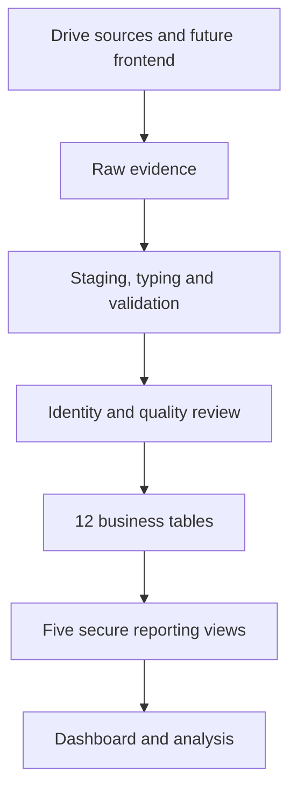

# Voice of Needy IDS reduced data architecture

**Status:** Version 3 proposal; GitHub documentation only.

## Architecture

| Layer | Objects | Rule |
|---|---|---|
| Raw/staging | Import-specific data, not programme tables | Immutable evidence; originals never modified |
| Core | 12 business tables | Frontend and approved migration write here |
| Audit | `import_runs`, `source_records`, `change_log` | Provenance, identity/quality decisions and changes |
| Security | `user_access` | Least-privilege role and scope assignment |
| Reporting | Five SQL views | Read-only, pseudonymised where required, no duplicate storage |

## Core domains

| Domain | Tables |
|---|---|
| Participant journey | `participants`, `outreach_records` |
| Programme delivery | `projects`, `batches`, `enrolments`, `sessions`, `attendance`, `assessments` |
| Employment pathway | `employers`, `job_opportunities`, `placements`, `followups` |

## Migration process

`Extract → register source → stage → standardise → validate → resolve identity → review exceptions → upsert core → reconcile → refresh views`

All reruns use import/source keys and upserts. Source, staged, loaded, rejected and unresolved counts are reconciled for every dataset.

## Frontend boundary

- Frontend writes to approved core operations only.
- Raw, audit and reporting layers are not directly editable.
- Participant creation returns a stable UUID and participant code.
- Attendance submission performs idempotent enrolment-session upserts.
- A placement can progress from mapping to joining without creating a second employment object.
- Follow-ups are appended; previous checkpoints are never overwritten.

## Scope boundary

No Supabase configuration, SQL schema, production data migration or Vercel change is included at this checkpoint.
