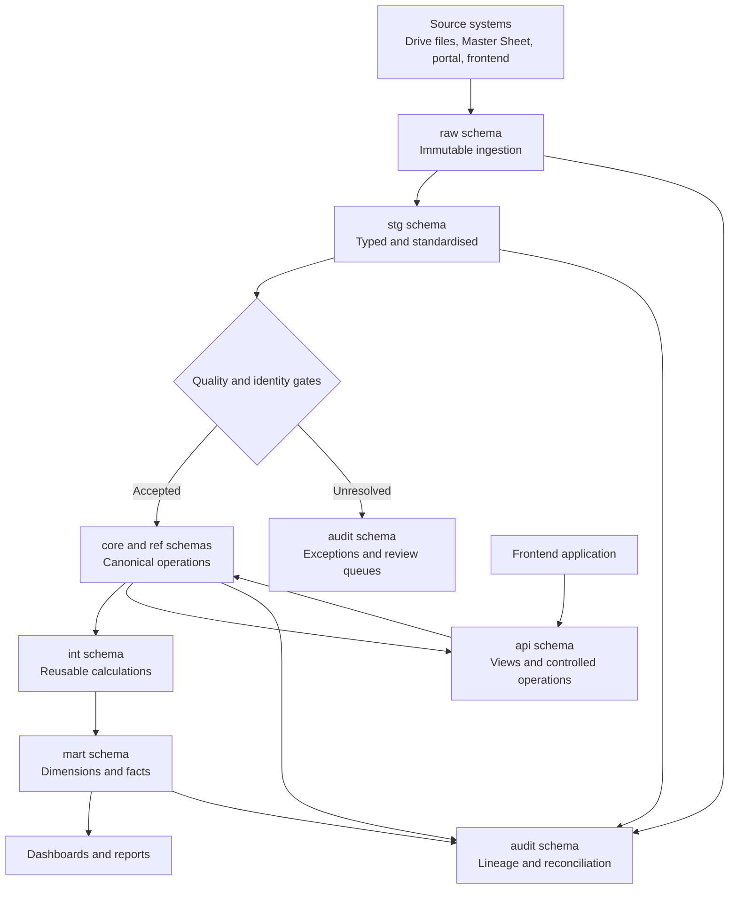
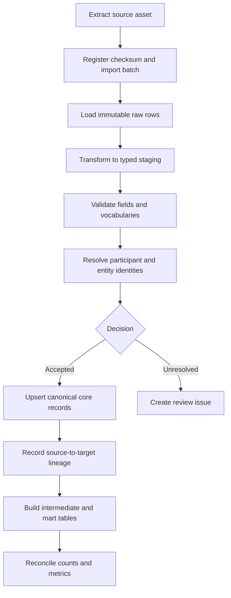
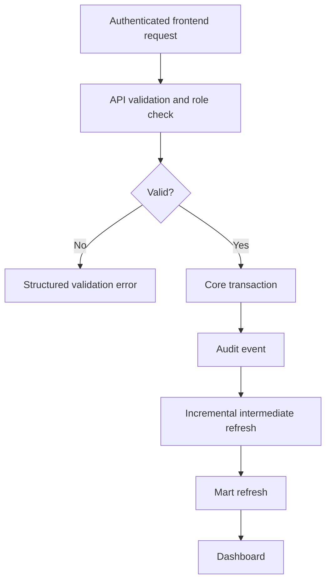

# Voice of Needy IDS data architecture

**Status:** Detailed architecture proposal for analyst, engineering and senior-management review. No database objects have been created.

This document defines the complete data path from historical Drive sources and future frontend submissions to operational tables, validation queues and dashboard-ready datasets. It follows the Goalkeep pattern of explicit source, staging, intermediate and final tables, with additional operational and governance layers required for a production backend.

Related documents:

- [Core relational model and ERDs](data-model.md)
- [Logical data dictionary](data-dictionary.md)
- [Dashboard and reporting model](dashboard-data-model.md)
- [Senior-manager review pack](senior-manager-data-model-review.md)
- [Source inventory](source-inventory.csv)

## 1. Architecture goals

The architecture must:

1. Preserve every historical source observation and its exact origin.
2. Keep raw ingestion separate from cleaned and canonical data.
3. Support unresolved identities without incorrectly creating or merging people.
4. Support current operations through frontend forms.
5. Support repeat sourcing, interactions, registrations, enrolments, placements and jobs.
6. Produce dashboard-ready tables with explicit grain and no dashboard-side transformation.
7. Make every count reconcilable from source to dashboard.
8. Allow idempotent migration reruns.
9. Isolate personal and disability information from broad reporting access.
10. Remain understandable and maintainable after handover to VoN.

## 2. End-to-end architecture

## 3. Layer definitions

| Layer | Database schema or surface | Purpose | Mutation rule | Primary consumers |
| --- | --- | --- | --- | --- |
| Source | Drive, Master Sheet, portal, frontend | Original evidence and ongoing input | Original files remain unchanged | Migration process, analysts |
| Raw | `raw` | Immutable source snapshots and row payloads | Insert-only by import run | Staging transformations, audit |
| Staging | `stg` | Typed, standardised domain rows with source values retained | Rebuilt/upserted by deterministic pipeline | Identity and validation gates |
| Reference | `ref` | Approved programmes, projects, locations, statuses and vocabularies | Controlled administration | Core, intermediate and marts |
| Core | `core` | Normalised operational source of truth | Controlled frontend/API and migration writes | Frontend, intermediate models |
| Audit | `audit` | Import runs, lineage, exceptions, identity review and record-change evidence | Append or controlled workflow updates | Analysts, administrators |
| Intermediate | `int` | Reusable joins, state calculations and summaries | Pipeline-managed | Reporting marts |
| Mart/final | `mart` | Dashboard-ready dimensions, facts and snapshots | Pipeline-managed | BI dashboards and extracts |
| API | `api` | Stable frontend views and controlled write operations | Versioned interface | Frontend application |

## 4. Source layer

### 4.1 Historical sources in scope

| Source group | Examples | Expected domain |
| --- | --- | --- |
| Current Master Sheet | Participant Registry, Sourcing, Mobilization, Training, Batches, Sessions, Attendance, Assessments, Placements, Follow-ups, verification tabs | Current working IDs, organised target fields and exception queues |
| Original trainee workbooks | All Trainees 2017–2026 and donor tabs | Registration, batch, training, completion, Kredo and placement fields |
| Consolidated trainees | Consolidated trainee extract | Cross-project staging; not an independent source |
| Outreach and district lists | Translated and original sourcing lists | Sourcing leads and candidate profiles |
| Mobilisation files | Telecaller and November call files | Contact attempts and outcomes |
| Attendance registers | Structured and scanned registers | Session/date attendance evidence |
| Candidate reports | Individual questionnaire/counselling files | Readiness, barriers and observations |
| Employer lists | Employer, HR, role and vacancy sheets | Employer directory and opportunities |
| Portal export | Recent beneficiary/registration data | Recent registration structure |
| Donor reports | Quarterly/annual reports | Aggregate validation only, not person-level facts |
| Future frontend | Approved forms and workflows | New operational data |

### 4.2 Source authority classes

Every `raw.source_asset` receives one class:

- `original_record`
- `verified_portal`
- `translated_copy`
- `consolidated_workbook`
- `working_master`
- `manual_scan`
- `aggregate_report`
- `derived_or_temporary`
- `frontend_submission`

Authority is determined field by field. A clean consolidated workbook does not automatically override an original record.

## 5. Raw schema

Raw tables preserve what was received. They are not queried by dashboards or the frontend.

| Table | Grain | Primary key | Important fields | Source |
| --- | --- | --- | --- | --- |
| `raw.import_batches` | One pipeline execution | `import_batch_id` | started/finished time, pipeline version, status, counts, checksum | Migration process |
| `raw.source_assets` | One logical file/version | `source_asset_id` | Drive ID, file name, MIME type, authority class, checksum, reporting period | Drive inventory |
| `raw.source_tabs` | One workbook tab/table | `source_tab_id` | asset, tab name, header row, detected schema, row count | Workbook profiling |
| `raw.source_records` | One source row/record/version | `source_record_id` | asset, tab, row locator, row fingerprint, payload JSON, import batch | All row-level sources |
| `raw.source_files_unstructured` | One scan/document page reference | `unstructured_record_id` | asset, page/image reference, extraction status | PDFs and scans |
| `raw.frontend_submissions` | One received frontend request | `submission_id` | actor, operation, payload, request ID, validation status | Future frontend |

### Raw invariants

- A repeated import with the same asset checksum and row fingerprint must not create a second logical source record.
- Corrected source versions create new raw versions; they do not overwrite old payloads.
- Raw payloads retain original headers and values.
- Sensitive payload access is restricted to migration and authorised administrators.
- Raw tables are not a substitute for operational tables.

## 6. Staging schema

Staging tables convert multiple source structures into consistent domain-shaped records. They retain source values, canonical candidate values, validation flags and provenance.

### 6.1 Staging table catalogue

| Table | Grain | Natural/cardinality key | Main inputs | Core destination |
| --- | --- | --- | --- | --- |
| `stg.participant_profiles` | One source profile observation | source record | Master Registry, trainees, portal, questionnaires | `core.participants`, contacts, profiles |
| `stg.participant_identifiers` | One identifier observation | source record + identifier type + value | Master, portal, original tabs | `core.participant_identifiers` |
| `stg.source_leads` | One person/list occurrence | source record | district/outreach/UDID/referral lists | `core.source_leads` |
| `stg.mobilisation_interactions` | One observed contact attempt | source record + attempt locator | call files and verified Master rows | `core.mobilisation_interactions` |
| `stg.registrations` | One source registration event | source record + programme/project | portal and original trainee sources | `core.registrations` |
| `stg.training_batches` | One source batch observation | source batch code or derived candidate key | original project tabs, Master Batch | `core.training_batches` |
| `stg.enrolments` | One participant–batch source record | source candidate/enrolment ID | trainee records and portal | `core.enrolments` |
| `stg.batch_sessions` | One planned/actual source session | source session/batch + date/topic | session plan and future frontend | `core.batch_sessions` |
| `stg.attendance_marks` | One participant–session/date mark | source row + attendance column/date | attendance workbooks/scans | `core.attendance` |
| `stg.assessment_results` | One participant–instrument–period result | source row + measure | Kredo/questionnaire/approved assessments | `core.assessment_results` |
| `stg.employers` | One source employer observation | normalised name + corroboration | employer lists and placement fields | `core.employers` |
| `stg.job_opportunities` | One vacancy/role observation | source opportunity locator | employer/vacancy sheets | `core.job_opportunities` |
| `stg.placement_events` | One participant placement-stage observation | source record + stage/date | trainee and placement sources | placement attempts/employment |
| `stg.followup_interactions` | One observed follow-up | source record + interaction date | future/verified follow-up source | `core.followups` |
| `stg.reference_values` | One original-to-canonical value candidate | domain + original value | All domains | `ref.reference_values` |

### 6.2 Standard staging columns

Every staging table includes:

- `stg_record_id`
- `source_record_id`
- `import_batch_id`
- `source_authority_class`
- original source identifiers
- original values where standardisation occurred
- candidate canonical values
- `validation_status`
- `identity_resolution_status`
- `transformation_version`
- `loaded_at`

### 6.3 Staging validation states

- `accepted`
- `accepted_with_warning`
- `rejected`
- `identity_review_required`
- `business_review_required`
- `source_conflict`
- `not_applicable`

A staging record is never silently dropped.

## 7. Reference schema

| Table | Grain | Purpose |
| --- | --- | --- |
| `ref.programmes` | One programme | Approved programme vocabulary |
| `ref.projects` | One donor/project implementation | Project dates, programme and donor |
| `ref.donors` | One donor | Canonical donor organisation |
| `ref.locations` | One geographic unit | Hierarchical state/district/taluk/city/village |
| `ref.training_sites` | One physical/temporary site | Delivery location separated from geography |
| `ref.session_definitions` | One curriculum session/topic/version | Reusable session catalogue |
| `ref.assessment_instruments` | One instrument/version | Instrument, scale, domains and scoring |
| `ref.reference_values` | One approved domain value | Status/category vocabulary and source mappings |
| `ref.calendar_dates` | One date | Financial year, month, quarter and reporting periods |

Small closed status lists can be PostgreSQL enums or check constraints when change frequency is low. Business-maintained vocabularies remain reference tables.

## 8. Canonical core schema

The core schema is the operational source of truth. It is normalised to prevent duplication and to preserve repeated journeys.

### 8.1 Participant and identity

| Table | Grain | Primary key | Important relationships |
| --- | --- | --- | --- |
| `core.participants` | One canonical person | `participant_id` | Parent of participant journey |
| `core.participant_identifiers` | One identifier per participant/system/type | `participant_identifier_id` | Participant, source record |
| `core.participant_contacts` | One contact method/version | `participant_contact_id` | Participant |
| `core.participant_profiles` | One profile version/effective period | `participant_profile_id` | Participant, location |
| `core.participant_document_checks` | One participant/registration/document type check | `document_check_id` | Participant, registration |

### 8.2 Sourcing and mobilisation

| Table | Grain | Primary key | Important relationships |
| --- | --- | --- | --- |
| `core.source_leads` | One source-list occurrence | `source_lead_id` | Optional participant, source record |
| `core.mobilisation_assignments` | One lead assignment period | `assignment_id` | Lead, user |
| `core.mobilisation_interactions` | One observed call/visit/counselling interaction | `interaction_id` | Lead, optional participant, staff |
| `core.referrals` | One referral event | `referral_id` | Lead/participant, referrer |

### 8.3 Registration and training

| Table | Grain | Primary key | Important relationships |
| --- | --- | --- | --- |
| `core.registrations` | One participant registration/application | `registration_id` | Participant, programme, project |
| `core.training_batches` | One delivery batch | `batch_id` | Programme, project, training site |
| `core.enrolments` | One participant membership in one batch | `enrolment_id` | Participant, registration, batch |
| `core.batch_sessions` | One planned/actual session occurrence | `batch_session_id` | Batch, session definition, trainer |
| `core.attendance` | One enrolment × batch session | `attendance_id` | Enrolment, batch session |
| `core.assessment_events` | One assessment occurrence for batch/enrolment scope | `assessment_event_id` | Instrument, batch/session |
| `core.assessment_results` | One enrolment × assessment event × domain/measure | `assessment_result_id` | Enrolment, event |
| `core.training_completions` | One current completion decision per enrolment | `training_completion_id` | Enrolment |

### 8.4 Employer, placement and retention

| Table | Grain | Primary key | Important relationships |
| --- | --- | --- | --- |
| `core.employers` | One canonical employer | `employer_id` | Parent of contacts/opportunities/jobs |
| `core.employer_contacts` | One employer contact/version | `employer_contact_id` | Employer |
| `core.job_opportunities` | One vacancy/role opening | `job_opportunity_id` | Employer, work location |
| `core.placement_attempts` | One participant × opportunity placement episode | `placement_attempt_id` | Participant, enrolment, opportunity |
| `core.placement_stage_events` | One stage change within an attempt | `placement_stage_event_id` | Placement attempt |
| `core.employments` | One confirmed employment episode | `employment_id` | Participant, employer, opportunity |
| `core.followup_schedules` | One required checkpoint per employment | `followup_schedule_id` | Employment, checkpoint type |
| `core.followups` | One observed follow-up interaction | `followup_id` | Schedule, employment, participant |
| `core.support_interventions` | One support action | `support_intervention_id` | Employment/follow-up |

### 8.5 Users and responsibility

| Table | Grain | Purpose |
| --- | --- | --- |
| `core.user_profiles` | One authenticated user | Staff/application profile |
| `core.roles` | One role definition | Mobiliser, trainer, placement officer, manager, administrator |
| `core.user_role_assignments` | One user × role × scope × validity period | Programme/project/location access |
| `core.record_ownership` | One responsibility assignment | Operational ownership and queues |

## 9. Audit and governance schema

| Table | Grain | Purpose |
| --- | --- | --- |
| `audit.import_reconciliations` | One dataset/import run | Source, staged, accepted, rejected and unresolved counts |
| `audit.record_lineage` | One source-to-target link | Exact source record, transformation and target entity |
| `audit.data_quality_issues` | One detected issue | Severity, owner, workflow and resolution |
| `audit.identity_match_candidates` | One possible identity link | Signals, conflicts, confidence and human decision |
| `audit.participant_merge_events` | One approved merge/unmerge event | Survivorship and redirected identifiers |
| `audit.record_change_events` | One operational mutation | Actor, old/new values, reason and request ID |
| `audit.access_events` | One sensitive access/export event | User, purpose and scope |
| `audit.pipeline_runs` | One transformation execution | Version, status and object counts |

Because VoN has many historical sources, source provenance is not optional. It is required to explain participant identity, attendance and placement discrepancies.

## 10. Intermediate schema

Intermediate models are reusable calculations. They must not become manual data-entry surfaces.

| Table/view | Grain | Inputs | Purpose |
| --- | --- | --- | --- |
| `int.participant_current_state` | One participant | All core journey tables | Current furthest/active stage without losing history |
| `int.participant_journey_events` | One participant event | Leads, interactions, registration, enrolment, placement, follow-up | Ordered participant timeline |
| `int.enrolment_attendance_summary` | One enrolment | Attendance and sessions | Scheduled, present, absent and attendance rate |
| `int.batch_session_delivery` | One batch session | Batch/session/attendance | Planned vs completed, participation and trainer |
| `int.batch_progress_summary` | One batch | Enrolment, sessions, completion | Batch progress and completion counts |
| `int.assessment_progress` | One enrolment × instrument/domain | Assessment results | Baseline/midline/final comparisons where valid |
| `int.placement_pipeline` | One placement attempt | Stage events, opportunity and participant | Latest valid placement stage and elapsed time |
| `int.employment_retention_schedule` | One employment × checkpoint | Employment and follow-up schedules | Due, completed, overdue and retention state |
| `int.employer_engagement_summary` | One employer × reporting period | Opportunities, attempts and employments | Engagement and hiring metrics |
| `int.data_quality_summary` | One domain × issue type × period | Audit issues | Open issues and resolution performance |

## 11. Mart/final schema

Final tables are designed backward from dashboard questions. They include required filter dimensions so BI tools only filter and aggregate.

| Table | Grain | Main dashboard use |
| --- | --- | --- |
| `mart.dim_date` | One calendar date | Date, month, quarter, financial year filters |
| `mart.dim_participant_reporting` | One participant reporting profile | Restricted demographic/disability breakdowns |
| `mart.dim_programme_project` | One programme/project | Donor and programme filters |
| `mart.dim_location_site` | One location/training site | Geography and centre/site filters |
| `mart.dim_batch` | One batch | Batch, cohort and training-period filters |
| `mart.dim_employer` | One employer | Employer and sector filters |
| `mart.fct_participant_journey` | One participant × journey stage × episode | Funnel and conversion |
| `mart.fct_mobilisation_interaction` | One mobilisation interaction | Mobiliser activity and outcomes |
| `mart.fct_training_enrolment` | One enrolment | Enrolment, completion and dropout |
| `mart.fct_session_delivery` | One batch session | Planned vs completed sessions |
| `mart.fct_attendance` | One enrolment × batch session | Attendance trends and thresholds |
| `mart.fct_assessment_result` | One enrolment × assessment × measure | Assessment progress |
| `mart.fct_placement_pipeline` | One placement attempt or stage event, per approved design | Referral-to-joining conversion |
| `mart.fct_employment_checkpoint` | One employment × retention checkpoint | 3/6/12-month retention |
| `mart.fct_employer_engagement` | One employer × period | Vacancies, interviews and hires |
| `mart.fct_data_quality` | One issue × reporting date/status | Completeness and unresolved cases |
| `mart.snapshot_executive_monthly` | One month × programme/project/location | Stable executive reporting snapshot |

Detailed mart columns and dashboard mapping are in [dashboard-data-model.md](dashboard-data-model.md).

## 12. API/frontend schema

The frontend should not write directly into staging or mart tables.

### Read views

| View | Purpose |
| --- | --- |
| `api.v_participant_search` | Minimum fields for authorised search and duplicate warning |
| `api.v_participant_profile` | Approved participant profile fields |
| `api.v_participant_timeline` | Ordered journey history |
| `api.v_leads_work_queue` | Mobilisation assignments and due actions |
| `api.v_batch_roster` | Batch and enrolment roster |
| `api.v_session_register` | Planned/actual sessions |
| `api.v_attendance_entry` | Session attendance entry and correction state |
| `api.v_placement_pipeline` | Candidate placement stages |
| `api.v_followups_due` | Due/overdue follow-ups |
| `api.v_data_quality_queue` | Authorised review exceptions |

### Controlled operations

Versioned functions or server-side endpoints should handle:

- create/update participant;
- create source lead and mobilisation interaction;
- submit registration;
- create batch and enrolment;
- schedule/update session;
- submit/correct attendance;
- record assessment;
- record placement stage and joining;
- schedule/complete follow-up;
- resolve identity or data-quality issue.

Each operation validates roles, stage transitions, idempotency/request ID and audit reason.

## 13. Data flow and transformation contracts

### 13.1 Historical migration

### 13.2 Future frontend data

## 14. Cardinality and reconciliation tests

Each table must declare its grain and cardinality key in an index/catalog, following the Goalkeep pipeline pattern.

Required tests include:

| Test | Example |
| --- | --- |
| Primary-key uniqueness | one `enrolment_id` per enrolment |
| Grain uniqueness | one attendance row per enrolment × batch session |
| Foreign-key integrity | attendance session belongs to enrolment's batch |
| Stage-order validity | joined cannot precede offer/selection under approved workflow |
| Date validity | session date within acceptable batch period or documented exception |
| Controlled values | statuses map to approved reference values |
| Identity decision | uncertain person link cannot enter core as confirmed |
| Source reconciliation | raw = accepted + rejected + unresolved |
| Mart reconciliation | mart counts trace back to core and approved definitions |
| Rerun idempotency | repeating import does not duplicate core records |

Cardinality failures are written to `audit.data_quality_issues` and surfaced in the data-quality dashboard.

## 15. Refresh and ownership model

| Object | Refresh pattern | Owner |
| --- | --- | --- |
| Raw historical imports | On approved migration run | Data engineering |
| Raw frontend submissions | Real time | Application/API |
| Staging | Per import run | Data engineering |
| Core frontend writes | Real time transaction | Operational team through API |
| Core historical migration | Approved controlled batches | Data engineering + analyst review |
| Intermediate | Incremental after core changes; periodic full validation | Data engineering |
| Marts | Scheduled/incremental; monthly snapshots locked after sign-off | Data engineering/analytics |
| Reference values | Controlled change process | Named business owner |
| Identity and exception queues | Workflow-driven | Analyst/authorised VoN reviewers |

## 16. Privacy and access boundaries

- Broad dashboards use reporting dimensions with only approved attributes.
- Direct participant contact, address, disability details, documents and salary data are not exposed by default.
- Mobilisers see assigned leads and required contact fields.
- Trainers see authorised rosters, access needs, sessions, attendance and assessments.
- Placement staff see approved employability and placement fields.
- Managers see aggregate dashboards and authorised case-level drill-down.
- Administrators manage roles, reference values and review queues.
- Service-role credentials remain server-side.

## 17. Implementation order

1. Approve programme journey, table grains, status definitions and first-release scope.
2. Complete source-to-staging mappings for priority files.
3. Finalise reference values and authority rules.
4. Finalise core physical schema and constraints.
5. Finalise identity-resolution and merge rules.
6. Define frontend API contracts.
7. Define dashboard questions and approve mart grains.
8. Create migrations and tests only after Supabase work is authorised.
9. Load a synthetic/de-identified fixture.
10. Execute historical migration in approved batches.
11. Reconcile every layer before release.

## 18. Review checkpoints

| Checkpoint | Approval required |
| --- | --- |
| Architecture | Layers, source authority, ownership and access boundaries |
| Core model | Entities, relationships, status definitions and identifiers |
| Dashboard model | Questions, metrics, grains, dimensions and filters |
| Migration | Source mappings, identity rules and reconciliation |
| Production | Security, RLS, release plan and approved data load |

This architecture does not authorise Supabase, Vercel or production migration work.
