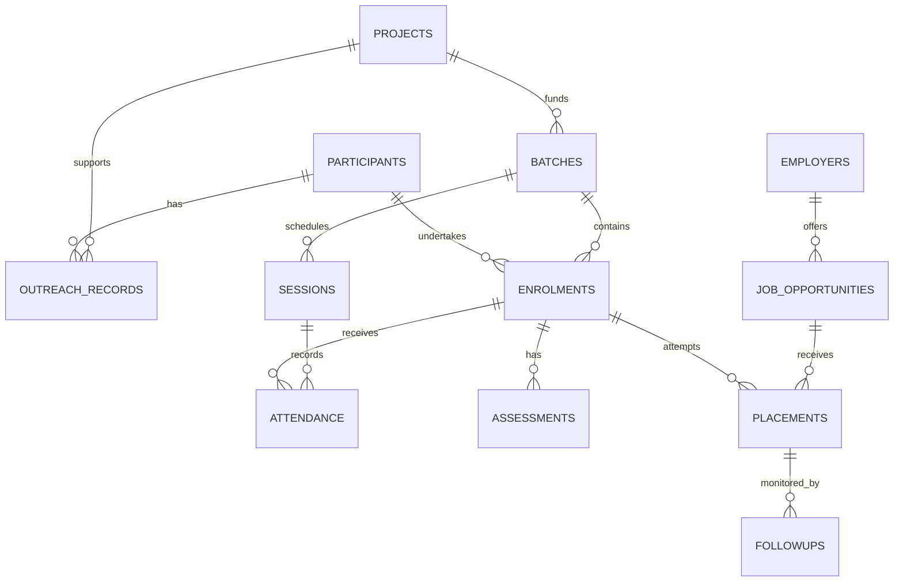
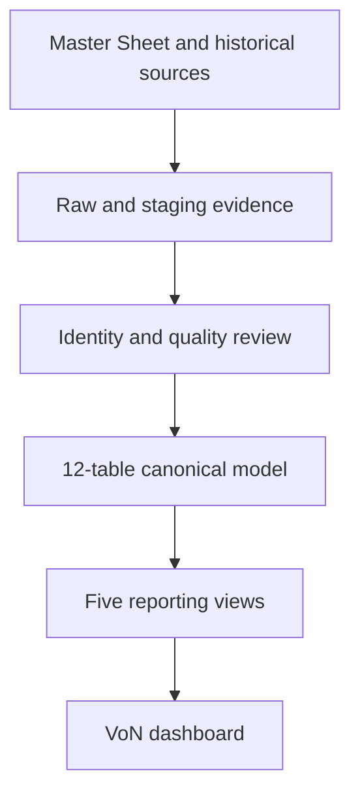
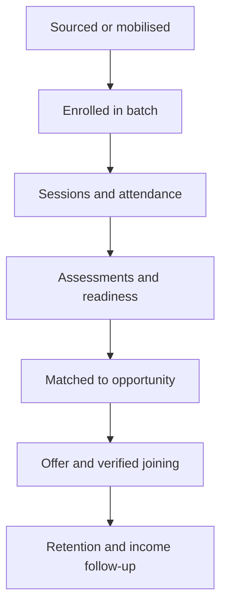

# Voice of Needy IDS Mermaid diagrams

**Version:** 3 reduced-table model

## Business model

## Source-to-dashboard flow

## Participant journey

GitHub renders these fenced Mermaid diagrams directly. The same relationships can later be exported to diagrams.net after business approval; maintaining an editable draw.io file before approval would create two competing design sources.
