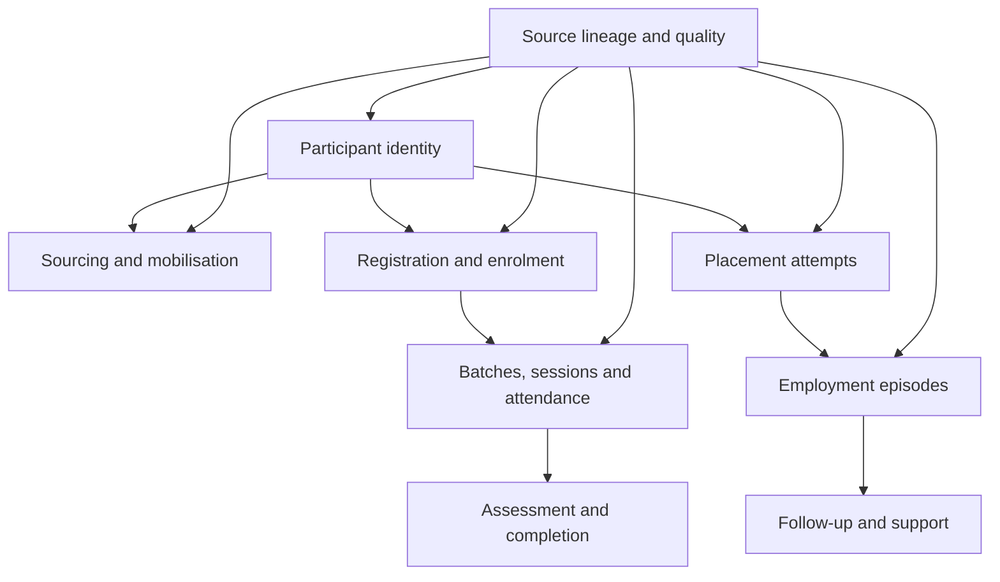
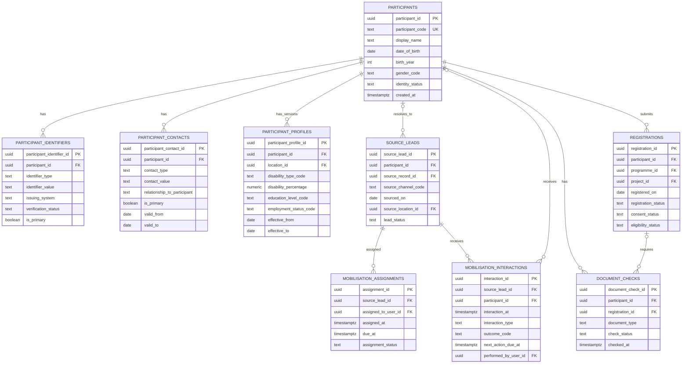
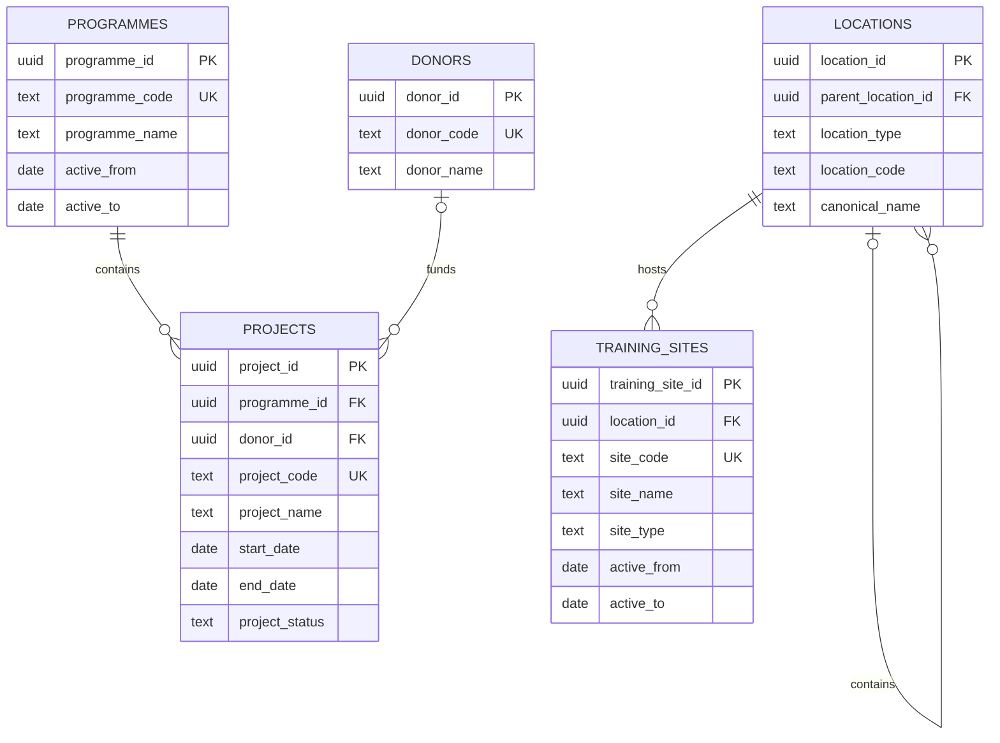
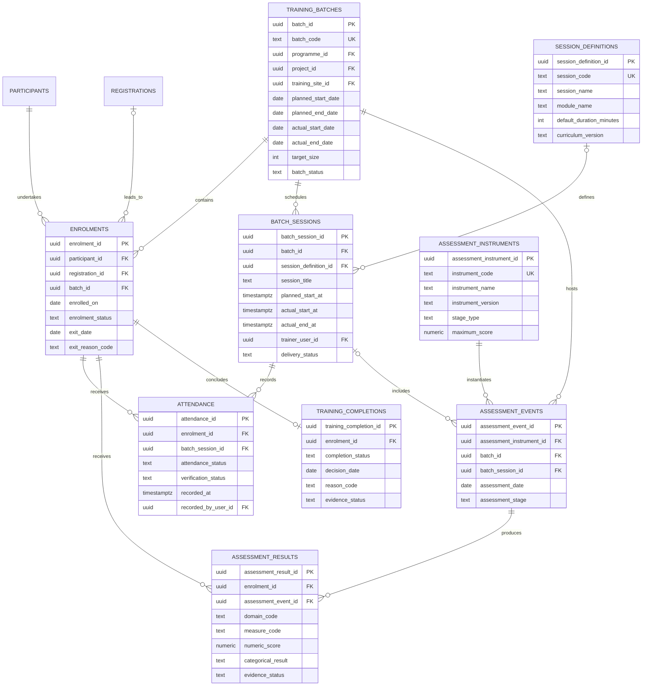
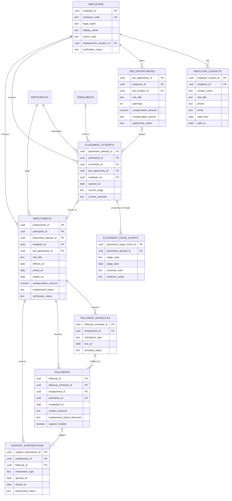
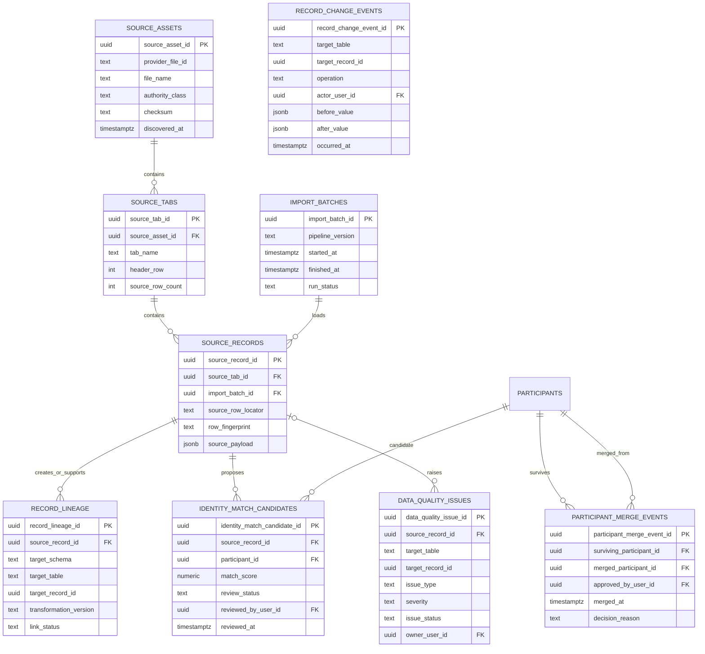
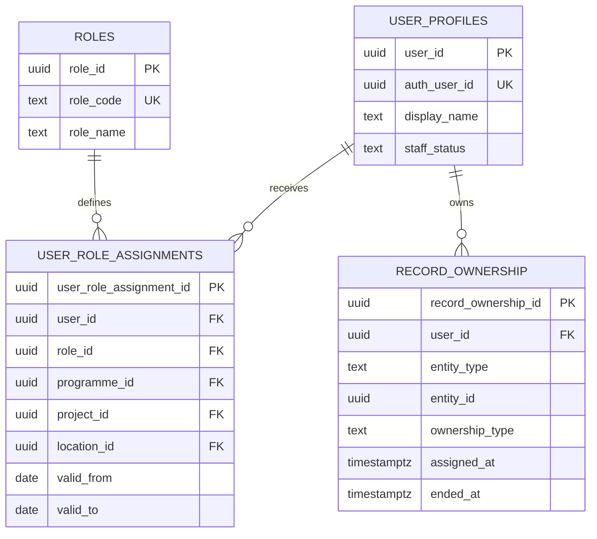

# Voice of Needy IDS core relational data model

**Status:** Detailed logical/physical proposal for review. No database schema has been created.

This document defines the canonical operational model and its exact relationships. The complete source-to-dashboard architecture is in [data-architecture.md](data-architecture.md), and dashboard facts/dimensions are in [dashboard-data-model.md](dashboard-data-model.md).

## 1. Modelling standard

- PostgreSQL schemas separate `ref`, `core`, `audit`, `raw`, `stg`, `int`, `mart` and `api`.
- Table names are plural nouns. Foreign-key columns use the referenced entity name, such as `participant_id`, `enrolment_id` and `batch_session_id`.
- Internal primary keys are UUIDs.
- Human-readable and historical identifiers are alternate keys, never primary database keys.
- Transaction/event tables record one observed occurrence per row.
- Current status is derived from status events where history matters.
- Closed status sets use check constraints/enums; business-maintained values use reference tables.
- Dates use `date`; real event times use `timestamptz`.
- Money stores numeric amount and currency/period separately.
- Every mutable operational row includes audit timestamps and actor/request metadata.
- Source lineage is stored separately rather than repeated as free text on operational tables.

## 2. Relationship overview

A participant may enter the system as an unresolved source lead. Registration, enrolment, completion, placement and employment are separate facts.

## 3. Participant identity, sourcing and registration ERD

### Relationship rules

1. `source_leads.participant_id` is nullable until identity is safely resolved.
2. A Master Sheet sourcing row is not automatically a mobilisation interaction.
3. A participant can have multiple contacts and profile versions.
4. Registration requires a participant but does not require an enrolment.
5. Document checks record status; full document data is stored only when approved and necessary.
6. Lead and interaction history remain after a person registers.

## 4. Programme, project and location reference ERD

A training site may be temporary. Historical centre text maps to a site/location only after review.

## 5. Training delivery ERD

### Training cardinalities and constraints

| Table | Declared grain | Uniqueness/validation |
| --- | --- | --- |
| `training_batches` | One operational batch | Unique approved batch code |
| `enrolments` | One participant membership in one batch | Flag duplicate active participant × batch; repeat batches allowed |
| `batch_sessions` | One scheduled/delivered session occurrence | Batch + planned occurrence key or immutable session ID |
| `attendance` | One enrolment × batch session | Unique active pair; enrolment and session must share batch |
| `assessment_events` | One assessment occurrence | Instrument + batch + date/stage |
| `assessment_results` | One enrolment × assessment event × domain/measure | Unique active combination |
| `training_completions` | One current decision per enrolment | Prior decisions retained in audit history |

### Session status

Use one controlled status, not independent booleans:

- `planned`
- `scheduled`
- `completed`
- `partially_completed`
- `postponed`
- `cancelled`
- `unknown_historical`

The Master Sheet planned-vs-completed view is generated from `batch_sessions`; it is not the storage design.

## 6. Placement, employment and retention ERD

### Placement design decisions

- Referral, interview, selection, offer and joining are stage events.
- A Boolean set such as `interviewed`, `selected`, `joined` is not used because contradictory states are possible.
- `placement_attempts.current_stage` is a cached/derived operational value; stage-event history is authoritative.
- An employment row is created only when the approved employment evidence rule is met.
- Multiple placement attempts and multiple employment episodes are allowed.
- Retention is evaluated per employment episode, not only per participant.

## 7. Source lineage, identity resolution and audit ERD

### Identity decision states

- `pending`
- `confirmed_match`
- `rejected_match`
- `insufficient_evidence`
- `conflict_requires_von`

Algorithmic scores prioritise review; they do not merge people.

## 8. User, role and scope model

Final role scope and RLS policies require VoN approval.

## 9. Master Sheet mapping

| Master Sheet tab | Raw/staging object | Canonical core objects | Dashboard/final output |
| --- | --- | --- | --- |
| Participant Registry | `stg.participant_profiles` | participants, identifiers, contacts, profiles | dim participant reporting |
| Sourcing | `stg.source_leads` | source leads, referrals | participant journey, sourcing funnel |
| Mobilization | `stg.mobilisation_interactions` | assignments, interactions | mobilisation interaction fact |
| Training | `stg.registrations`, `stg.enrolments` | registrations, enrolments, completions | training enrolment fact |
| Training Batch | `stg.training_batches` | training batches | batch dimension |
| Session planned vs complete | `stg.batch_sessions` | session definitions, batch sessions | session delivery fact |
| Daily attendance | `stg.attendance_marks` | attendance | attendance fact |
| Weekly assessments | `stg.assessment_results` | instruments, events, results | assessment-result fact |
| Placements | `stg.placement_events` | attempts, stage events, employment | placement pipeline fact |
| Follow-ups | `stg.followup_interactions` | schedules, follow-ups, support | employment checkpoint fact |
| Employers Data | `stg.employers`, opportunities | employers, contacts, opportunities | employer dimension/fact |
| Attendance Verify | identity/DQ staging | identity queue and quality issues | data-quality fact |
| Outreach Contacts Verify | lead/identity staging | source leads and identity queue | data-quality and sourcing facts |
| ID Mapping & Source Trace | raw and audit objects | identifiers and lineage | reconciliation reports |

## 10. Identifier design

| Entity | Internal key | Business/source identifier |
| --- | --- | --- |
| Participant | UUID `participant_id` | Approved `participant_code`; Master/portal/legacy IDs stored separately |
| Source lead | UUID | Source asset/tab/row fingerprint |
| Registration | UUID | Source registration number where available |
| Batch | UUID | Approved `batch_code`; original Pankh batch IDs preserved |
| Enrolment | UUID | Candidate/enrolment/registration ID as alternate identifier |
| Batch session | UUID | Optional generated human session code |
| Employer | UUID | Approved employer code and canonical legal name |
| Employment | UUID | Optional business employment episode code |
| Source record | UUID | File/version + tab + row locator + fingerprint |

IDs never depend on mutable names or spreadsheet row position alone.

## 11. Physical integrity rules

1. `participant_identifiers(issuing_system, identifier_type, identifier_value)` is unique for active identifiers.
2. `attendance(enrolment_id, batch_session_id)` is unique for the active record.
3. The attendance enrolment and session must belong to the same batch.
4. `assessment_results(enrolment_id, assessment_event_id, domain_code, measure_code)` is unique.
5. `followup_schedules(employment_id, checkpoint_type)` is unique unless an approved reschedule version exists.
6. Joining date cannot precede offer/selection evidence without an exception.
7. Employment end date cannot precede joining date.
8. Batch actual end cannot precede actual start.
9. Profile/contact effective periods cannot overlap when marked primary for the same type.
10. Every migrated core record has at least one lineage record.
11. Rejected/unresolved staging rows cannot be loaded as confirmed core events.
12. Corrections and merges create audit events; destructive deletion is not routine.

## 12. Historical versus future-entry requirements

| Area | Historical migration | Future frontend |
| --- | --- | --- |
| Missing dates | Allowed with explicit evidence status | Required for observed operational events |
| Unknown status | Allowed when source cannot establish value | User must select an approved status |
| Source lineage | Mandatory | Request ID and actor audit are mandatory |
| Participant identity | Can remain unresolved | Duplicate check before creation |
| Batch/session | Incomplete historical relationship can enter review | Valid batch/session relationship required |
| Placement | Historical reported value may remain unverified | Stage and evidence rules enforced |
| Follow-up | No fabricated events | Due schedule and completion workflow enforced |

## 13. Review decisions required

Senior managers and operational owners must approve:

- earliest stage for canonical participant creation;
- repeat enrolment and transfer rules;
- registration, completion, placement and retention definitions;
- session catalogue and adaptable-session rules;
- attendance and completion thresholds;
- assessment instruments and first-release scope;
- employer/job/placement stage vocabulary;
- 3-, 6- and 12-month follow-up rules;
- centre/training-site hierarchy;
- participant business ID format;
- data ownership, privacy and access;
- historical migration period and source authority.

After approval, the model will be converted into version-controlled SQL migrations only when backend implementation is authorised.
