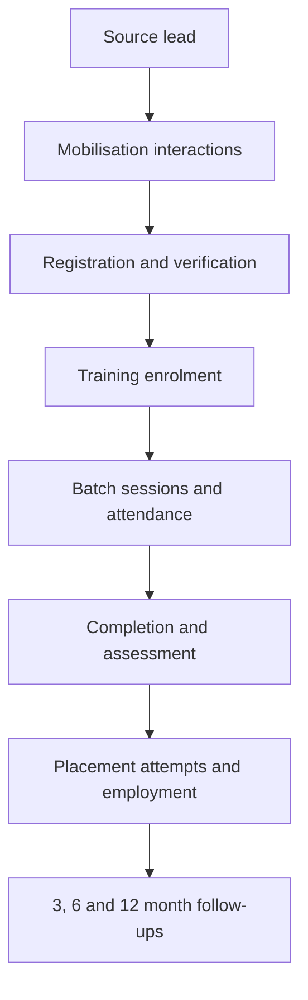
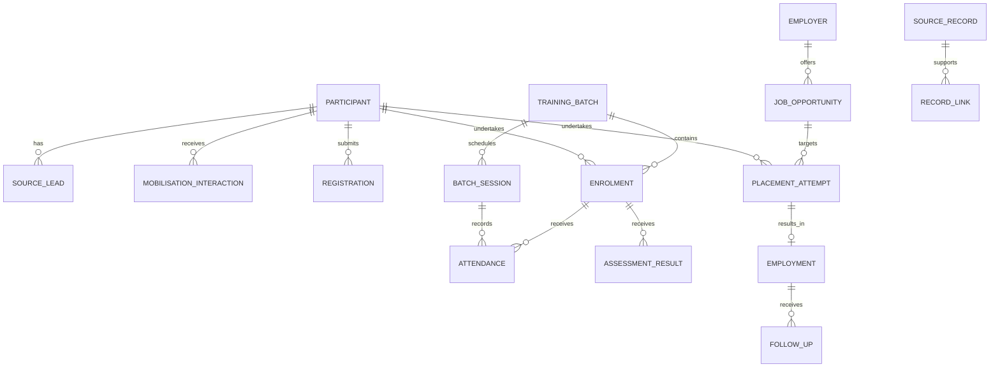

# Proposed Voice of Needy IDS data model

**Status:** Draft for analyst and senior-management review. This is not an approved production schema and has not been implemented in Supabase.

**Evidence basis:** VoN meeting notes, programme and Theory of Change documents, the source inventory, structural profiling of 120 spreadsheet files/400 worksheets, and the current VoN Master Sheet. The model preserves the Master Sheet's operational domains while separating people from the events that happen to them.

## 1. Design principles

1. One person has one canonical participant record, but may have many source observations, mobilisation interactions, registrations, enrolments, jobs and follow-ups.
2. A sourced lead can exist without registration or training.
3. Historical incompleteness is valid. Unknown, not collected, not applicable, pending and verified are different states.
4. Repeat enrolment and repeat placement are supported.
5. Every migrated record retains source-file, sheet and source-row lineage.
6. Uncertain identity matches remain in a review queue; names alone never trigger an automatic merge.
7. Sensitive disability, contact and document information is separated and access-controlled.
8. Operational transactions are stored as rows, not as an ever-growing set of spreadsheet columns.
9. Internal database keys are immutable UUIDs. Human-readable and legacy identifiers are stored separately.
10. The model remains compatible with future frontend forms without inventing missing historical events.

## 2. Business journey represented

This is a possible journey, not a mandatory straight line. A person may stop after sourcing, return later, repeat training, have multiple placement attempts or change jobs.

## 3. High-level entity relationship model

Supporting reference, governance and security entities are described below rather than displayed in the compact diagram.

## 4. Proposed domains and entities

### A. Participant identity

| Entity | Purpose | Important relationships |
| --- | --- | --- |
| `participant` | Canonical person record; does not imply training enrolment | Parent of journey events |
| `participant_identifier` | Current Master Sheet ID, candidate/enrolment ID, portal ID, historical IDs and approved identity references | Many identifiers per participant |
| `participant_contact` | Phone, email, address and communication preferences with validity dates | Many contacts per participant |
| `participant_profile` | Operational demographic and accessibility fields, including sensitive disability information | One or versioned profiles per participant |
| `participant_document_check` | Whether required documents were requested, received and verified; avoid storing unnecessary document values | Linked to participant/registration |
| `identity_match_candidate` | Confirmed, probable, rejected and unresolved cross-source identity links | Review queue, never auto-merges uncertain cases |

### B. Sourcing and mobilisation

| Entity | Purpose | Important relationships |
| --- | --- | --- |
| `source_lead` | A person/list observation received through UDID, referral, field activity, job fair, partner or other channel | May or may not link to a canonical participant |
| `mobilisation_assignment` | Assignment of a lead/list to a mobiliser | Linked to lead and staff |
| `mobilisation_interaction` | Each call, visit, counselling or follow-up attempt and its outcome | Multiple per lead/participant |
| `referral` | Referring person/organisation and referral outcome where separately required | Linked to lead/participant |

A row in the Master Sheet Mobilization tab should only become a mobilisation interaction when there is evidence that an interaction happened. Historical trainee rows with no verified call should not generate fabricated call events.

### C. Registration and programme structure

| Entity | Purpose | Important relationships |
| --- | --- | --- |
| `programme` | VoN programme or intervention | Parent of registrations/batches |
| `project` | Time-bound donor/project implementation | Linked to programme and donor |
| `donor` | Funding organisation | Linked to projects |
| `registration` | Formal application/consent/registration event | Many possible per participant over time |
| `location` | Normalised geographic hierarchy: state, district, block/taluk, city/village | Referenced by other entities |
| `training_site` | Physical or temporary place where training occurs | Linked to location; not assumed to be a permanent centre |

### D. Training delivery

| Entity | Purpose | Important relationships |
| --- | --- | --- |
| `training_batch` | A defined delivery group for a project/programme, site and period | Contains enrolments and scheduled sessions |
| `enrolment` | Participant membership in a batch | Many enrolments per participant allowed |
| `session_definition` | Reusable curriculum/topic definition | Used by batch sessions |
| `batch_session` | One planned/actual session for a batch, including schedule, trainer and completion state | Many per batch |
| `attendance` | One enrolment's status for one batch session/date | Unique per enrolment and session |
| `assessment_definition` | Baseline/midline/endline/weekly or other instrument definition | Used by results |
| `assessment_result` | Participant/enrolment result for an assessment event | Optional pending scope approval |
| `training_completion` | Completion decision, date, reason and evidence | One current outcome per enrolment, with audit history |

Sessions are stored as records. The Master Sheet's session columns can be generated as a reporting view, while the backend can add new sessions without changing the schema.

### E. Employer, placement and retention

| Entity | Purpose | Important relationships |
| --- | --- | --- |
| `employer` | Canonical employer organisation | Has contacts, opportunities and employment records |
| `employer_contact` | Employer contact person and validity period | Many per employer |
| `job_opportunity` | Role, location, openings, accessibility and compensation information | Offered by employer |
| `placement_attempt` | Referral, interview, selection, offer, rejection or withdrawal episode | Many per participant/opportunity |
| `employment` | Confirmed joining/employment episode | Result of an attempt; multiple jobs per participant |
| `follow_up` | Scheduled or completed 3-, 6-, 12-month or event-based follow-up | Linked primarily to employment and participant |
| `support_intervention` | Accommodation, counselling, replacement support or workplace issue assistance | Linked to employment/follow-up |

Selection, offer, joining and retention are different events. A participant should be counted as placed only according to the business definition approved by managers.

### F. Source lineage, quality and audit

| Entity | Purpose |
| --- | --- |
| `source_asset` | Original file/workbook/document identity, version and authority class |
| `source_record` | File, sheet/table and stable row fingerprint for each imported observation |
| `record_link` | Links a source record to the canonical entity/event it created or supported |
| `data_quality_issue` | Missing, invalid, conflicting, duplicate or unresolved condition and resolution status |
| `reference_value` | Approved controlled vocabulary and mapping from original values |
| `audit_event` | Who/what changed a record, when and why |

### G. Users and access

| Entity | Purpose |
| --- | --- |
| `user_profile` | Application user mapped to an authenticated account |
| `role` | Approved functional role such as mobiliser, trainer, placement officer, manager or administrator |
| `user_role_assignment` | Role plus programme/project/location scope and validity dates |
| `access_audit` | Sensitive-record access or export events where required |

The final role matrix and row-level access rules require organisational approval before implementation.

## 5. Master Sheet to model mapping

| Current Master Sheet tab | Proposed canonical destination |
| --- | --- |
| Participant Registry | `participant`, `participant_identifier`, `participant_contact`, `participant_profile` |
| Sourcing | `source_lead`, `source_record`, `referral` |
| Mobilization | `mobilisation_assignment`, `mobilisation_interaction` |
| Training | `registration`, `enrolment`, `training_completion` |
| Training Batch | `programme`, `project`, `training_batch`, `training_site` |
| Training-session planned vs complete | `session_definition`, `batch_session` |
| Training-Daily attendance | `attendance` |
| Training-Weekly assessments | `assessment_definition`, `assessment_result` |
| Placements | `job_opportunity`, `placement_attempt`, `employment` |
| Follow-ups | `follow_up`, `support_intervention` |
| Employers Data | `employer`, `employer_contact` |
| 2026 Attendance-Verify | `identity_match_candidate`, `data_quality_issue`, `source_record` |
| Outreach Contacts-Verify | `source_lead`, `identity_match_candidate`, `data_quality_issue` |
| ID Mapping & Source Trace | `participant_identifier`, `source_asset`, `source_record`, `record_link` |

The Master Sheet remains useful as the organised business reference and reconciliation artifact. It should not be the only authority for values copied from older sources.

## 6. Identifier strategy

| Identifier | Proposed rule |
| --- | --- |
| Internal primary key | Random immutable UUID; never shown as the only user-facing identifier |
| Participant business ID | Stable VoN-generated code, format to be approved; never derived from name, phone or row number |
| Source record ID | File/version + sheet/table + source-row fingerprint |
| Legacy/source ID | Preserved in `participant_identifier` with source and validity |
| Enrolment ID | New immutable ID for each participant–batch enrolment |
| Batch ID | Stable code independent of spreadsheet row or name changes |
| Session ID | New ID for each scheduled batch session |
| Employment ID | New ID for each confirmed employment episode |

Existing Master Sheet IDs should be retained as legacy/business identifiers unless validation shows collisions. They should not be silently replaced.

## 7. Key relationship and validation rules

1. A participant may have zero or many source leads, registrations, enrolments, placement attempts and jobs.
2. A lead may remain unmatched; unmatched records stay in staging/review rather than being deleted.
3. A registration does not automatically prove enrolment.
4. An enrolment must link to exactly one participant and one batch.
5. An attendance record must link to an enrolment and batch session belonging to the same batch.
6. Attendance must distinguish present, absent, excused, not scheduled and unknown/not recorded.
7. Training completion must distinguish completed, discontinued, transferred, in progress and unknown historical outcome.
8. A placement attempt is not an employment record until the approved joining/evidence rule is met.
9. Follow-up due dates can be derived, but completed follow-ups require an observed interaction and outcome.
10. Original categorical values are preserved while approved canonical values are mapped separately.
11. Sensitive fields are nullable when not collected and restricted according to purpose.
12. Deleting a participant should not be a routine operation; corrections, merges and access restrictions require an audit trail.

## 8. Current evidence informing the model

- 4,826 unique participant IDs currently exist in the Master Sheet.
- 4,945 sourcing rows represent 4,826 people.
- 2,470 records are outreach-only leads without confirmed training.
- 2,475 enrolment records represent 2,356 people across 103 batches.
- The 119 additional enrolment records require repeat-enrolment and identity review rather than automatic removal.
- Only 108 training rows currently have any daily attendance evidence.
- 1,399 rows contain at least one placement detail, but employer, role, salary and joining data are substantially incomplete.
- No follow-up rows are currently populated despite the stated 3-, 6- and 12-month requirement.

## 9. Items deliberately not finalised

The following require review before this becomes the canonical logical model:

- historical years included in migration;
- exact definition of registration, enrolment, training completion, placement and retention;
- whether weekly assessments are in the first release;
- location/training-site hierarchy and approved labels;
- participant business-ID format;
- authoritative source hierarchy by field;
- minimum required fields for future entry;
- roles, data ownership and access scope;
- document storage/retention approach;
- approved vocabularies and reporting indicators.

## 10. Approval gate

Senior managers should approve the business meanings, stage boundaries, ownership, status definitions and reporting rules. The analyst/backend workstream can then finalise field-level mappings, constraints and migration rules. No production schema or migration should be created from this draft until the review outcomes are recorded.
