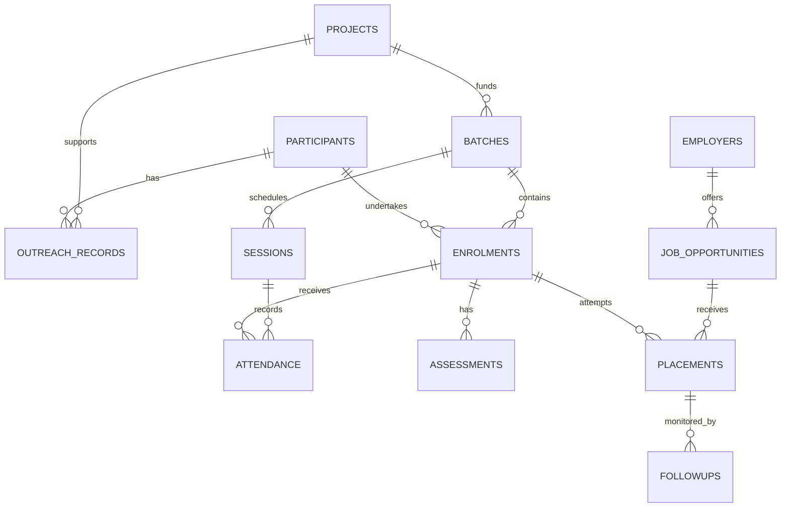

# Voice of Needy IDS reduced canonical data model

**Version:** 3 — reduced-table proposal  
**Status:** For analyst and senior-management review. No production schema or migration is authorised.

## 1. Result

The earlier model has been rebuilt using three inputs:

1. the 13 approved key questions;
2. the updated Voice of Needy Master Sheet, including its newly populated and verification tabs;
3. the operational requirement to support future frontend entry without reproducing every spreadsheet tab as a database table.

The revised design uses:

- **12 business tables**;
- **3 migration/audit tables**;
- **1 access-control table**;
- **5 dashboard views**, not additional dashboard tables.

Total proposed physical tables for the first release: **16**, down from 29 objects in the previous proposal. No source field is discarded: repeated spreadsheet columns are converted to rows, secondary identifiers and low-volume supporting attributes are retained in structured JSON where a separate lifecycle is not justified, and raw/source lineage remains auditable.

## 2. Table-reduction rules

A separate table is created only if the data:

- repeats independently over time;
- represents a real many-to-many relationship;
- has its own workflow or status lifecycle;
- must be queried at a different grain; or
- must be preserved separately for migration/audit purposes.

Single-valued information stays with its parent record. Stable dropdowns use database constraints/configuration rather than lookup tables. Dashboard outputs are views rather than stored duplicates.

## 3. Business tables

| # | Table | Grain | Master Sheet coverage |
|---:|---|---|---|
| 1 | `participants` | One real person | Participant Registry; identity/profile fields from Sourcing and Mobilization |
| 2 | `outreach_records` | One sourcing or mobilisation contact/event | Sourcing; Mobilization; Outreach Contacts - Verify |
| 3 | `projects` | One programme/donor project | Project/donor and financial-year context used across tabs |
| 4 | `batches` | One training batch | Training Batch; Training Plans - Source References |
| 5 | `enrolments` | One participant's attempt in one batch | Training; training/dropout evidence; readiness status |
| 6 | `sessions` | One planned/delivered session for one batch | Training - session planned vs complete |
| 7 | `attendance` | One enrolment-session attendance result | Daily attendance; 2026 Attendance - Source Roster/Verify |
| 8 | `assessments` | One enrolment-assessment-point/domain/week result | Weekly assessments; baseline/endline/Kredo fields |
| 9 | `employers` | One employer organisation | Employers Data |
| 10 | `job_opportunities` | One role/vacancy opportunity at an employer | Employer roles, requirements, salary and vacancy counts |
| 11 | `placements` | One candidate-opportunity attempt, including joining outcome | Placements; placement dropout evidence |
| 12 | `followups` | One employment follow-up/checkpoint | Follow-ups; retention and income verification |

## 4. Reduced model Mermaid ERD

## 5. Why these tables remain separate

### `participants` and `enrolments`

A person can attend more than one batch or programme. Combining these would duplicate identity/profile information and make repeat participation unreliable.

### `batches`, `sessions` and `attendance`

A batch has many sessions, and each session has many participant attendance records. The Master Sheet's Day 1–46 and Session 1–45 columns are a spreadsheet presentation; the database stores them as rows so additional days/sessions require no schema change.

### `assessments`

Weekly, baseline, midline, endline and Kredo assessments repeat by participant and period. One assessment table stores the point/week, domain, rubric version, score and completion status without separate event/result/rubric tables.

### `employers`, `job_opportunities` and `placements`

One employer can have several roles/vacancies, and one participant can be considered for several opportunities. Placement now combines candidate mapping, suitability, pipeline stage, offer, verified joining and employment-start information. A separate employment table is not required for the current workflow.

### `followups`

Employment status, current workplace, salary and exit reason can change at each follow-up. These must remain repeatable records rather than columns on placement.

## 6. Consolidations from version 2

| Previous tables/concepts | Version 3 treatment | Information-loss protection |
|---|---|---|
| Participant identifiers, contacts and support profile | Merged into `participants` | Primary values remain columns; alternative IDs/contacts and additional support attributes use validated JSON arrays |
| Mobilisation cases and interactions | Merged into `outreach_records` | Each sourcing/contact attempt remains one dated row with type, response and status |
| Assessment events, results and rubric table | Merged into `assessments` | Each point/domain/week remains a row; rubric version and maximum score remain fields |
| Candidate-vacancy matches and employments | Merged into `placements` | Pipeline stage, offer, join date, role, salary and verification remain in the same attempt record |
| Reference-value table | Removed | Stable values use check constraints/enums; controlled lists are versioned in repository configuration |
| Location table | Removed for release 1 | Standard centre/district/state codes remain fields on projects, batches and opportunities |
| Readiness review table | Merged into `enrolments` | Latest profile/document/resume/interview readiness flags and review date remain available |
| Income observation table | Not created | Joining income is on placement; follow-up income is on follow-up |
| Dashboard fact/dimension tables | Replaced with views | Views are reproducible from core and do not duplicate data |
| Identity-review and data-quality issue tables | Merged into `audit.source_records` | Match status, review decision, issues and resolution fields remain traceable |

## 7. Key fields and relationships

| Table | Primary key | Main foreign keys | Important uniqueness rule |
|---|---|---|---|
| `participants` | `participant_id` UUID | — | `participant_code` unique; no name-based merge |
| `outreach_records` | `outreach_record_id` | participant, project | Source key unique within import; participant may be null until resolved |
| `projects` | `project_id` | — | `project_code` unique |
| `batches` | `batch_id` | project | `batch_code` unique |
| `enrolments` | `enrolment_id` | participant, batch | `(participant_id, batch_id, attempt_number)` unique |
| `sessions` | `session_id` | batch | `(batch_id, session_number)` unique |
| `attendance` | `attendance_id` | enrolment, session | `(enrolment_id, session_id)` unique |
| `assessments` | `assessment_id` | enrolment | `(enrolment_id, assessment_type, period_code, domain_code, attempt_number)` unique |
| `employers` | `employer_id` | — | Normalised name + location reviewed, not blindly auto-merged |
| `job_opportunities` | `job_opportunity_id` | employer, optional project | One role/vacancy record |
| `placements` | `placement_id` | enrolment, opportunity | `(enrolment_id, job_opportunity_id, attempt_number)` unique |
| `followups` | `followup_id` | placement | `(placement_id, checkpoint_month, attempt_number)` unique |

## 8. Migration and platform tables

| Table | Purpose |
|---|---|
| `audit.import_runs` | One controlled import execution with source/staged/loaded/rejected/unresolved counts |
| `audit.source_records` | Source file/tab/row, checksum, raw snapshot/reference, identity decision, quality issues and target IDs |
| `audit.change_log` | Material changes to protected core records, including actor and timestamp |
| `security.user_access` | Auth user, role, optional project/centre scope, validity and active status |

These four tables are infrastructure controls, not additional programme entities.

## 9. Master Sheet observations reflected in the model

- Participant Registry now contains 4,826 participant rows and becomes the main participant seed, subject to identity review.
- Sourcing and Mobilization each contain roughly 4,950 populated records; both map to `outreach_records` rather than two independent person tables.
- Training contains 2,487 populated participant-training rows and maps to `enrolments`.
- The session and batch tabs contain 105 populated batch rows; session-number columns are normalised into `sessions`.
- Daily attendance and weekly-assessment tabs each contain 2,475 populated participant rows; day/week columns are normalised into repeatable rows.
- Employers Data contains 131 populated employers/source rows.
- Placements has participant rows but many are presently incomplete; missing placement details remain null/pending, not fabricated.
- Follow-ups currently contains 6 populated records, confirming that repeatable follow-up rows are needed but a larger employment submodel is not yet justified.

Counts describe the current Master Sheet structure and are not migration acceptance counts.

## 10. Data-preservation rules

- Original values remain in raw/staging evidence and `audit.source_records`.
- Normalised values never overwrite the source value.
- Unknown, not collected, not applicable, pending and unverified are distinct states.
- Alternative identifiers/contacts stored in JSON use validated schemas, not free-form blobs.
- Uncertain identity matches are held for review and never automatically merged.
- A model reduction never authorises deletion of source or verification tabs.

## 11. Approval gate

Senior managers should approve the journey, dashboard definitions and release scope. The analyst/technical reviewer should approve grains, fields, constraints, JSON structures and source mappings. Only after approval should SQL migrations or production data loading begin.
