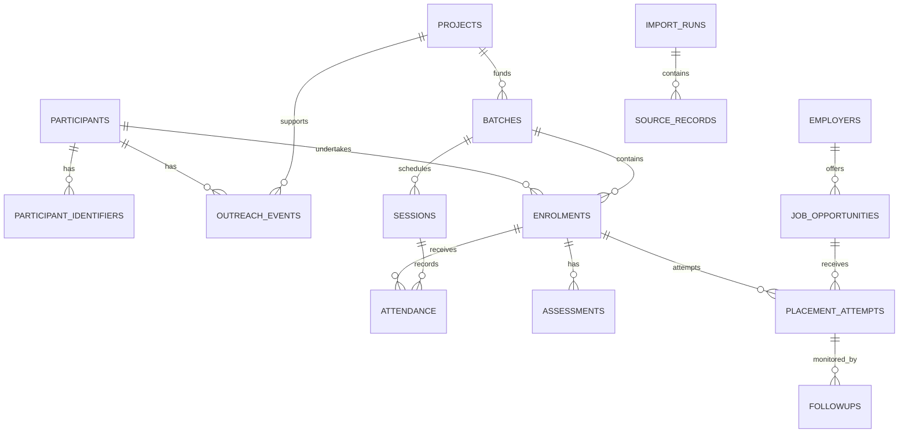

# Voice of Needy IDS professional data model

**Version:** 4 proposal  
**Status:** Detailed logical model for review; no production schema or migration is authorised.

## Deliverables

- Editable two-page diagrams.net model: [`docs/diagrams/von-ids-data-model-v4.drawio`](diagrams/von-ids-data-model-v4.drawio)
- SVG preview: [`docs/diagrams/von-ids-data-model-v4.svg`](diagrams/von-ids-data-model-v4.svg)
- PNG preview: [`docs/diagrams/von-ids-data-model-v4.png`](diagrams/von-ids-data-model-v4.png)
- Field-level dictionary: [`docs/data-dictionary.md`](data-dictionary.md)

The draw.io model follows the supplied reference structure: page 1 shows source/staging/core/reporting lineage; page 2 shows every table with business purpose, fields, data types, PK/FK markers, nullability/constraints and relationship lines.

## Model size

| Layer | Physical tables | Notes |
|---|---:|---|
| Canonical core | 13 | Participant journey, programme delivery and employment outcomes |
| Staging/migration | 2 | Import execution and record-level source lineage/identity review |
| Audit | 1 | Material change history |
| Security | 1 | Auth role and project/centre scope |
| Reporting | 0 | Five SQL views; no duplicated dashboard tables |
| **Total** | **17** | Reduced but properly normalised |

## Canonical core tables

| # | Table | Grain / responsibility |
|---:|---|---|
| 1 | `core.participants` | One canonical person; current identity, profile, contact and support details. |
| 2 | `core.participant_identifiers` | Multiple VoN, legacy, candidate, roster and external identifiers per participant. |
| 3 | `core.projects` | Programme/donor project context used across mobilisation, delivery and outcomes. |
| 4 | `core.outreach_events` | One sourcing, mobilisation, call or eligibility event; may precede identity resolution. |
| 5 | `core.batches` | One training cohort with planned and actual delivery context. |
| 6 | `core.enrolments` | One participant attempt in one batch; training, completion, dropout and readiness. |
| 7 | `core.sessions` | One planned/delivered session for one batch; normalises Session 01–45 columns. |
| 8 | `core.attendance` | One enrolment-session result; normalises Day 01–46 marks and source rosters. |
| 9 | `core.assessments` | One enrolment, assessment point/week and domain result. |
| 10 | `core.employers` | One employer organisation and its current engagement profile. |
| 11 | `core.job_opportunities` | One role/vacancy at one employer; supports open-vacancy and matching questions. |
| 12 | `core.placement_attempts` | One candidate-opportunity attempt from mapping through verified joining/exit. |
| 13 | `core.followups` | One employment follow-up/checkpoint attempt after placement. |

## Control tables

| Table | Responsibility |
|---|---|
| `staging.import_runs` | One repeatable import execution with reconciliation counts. |
| `staging.source_records` | One immutable source row plus validation, identity decision and target lineage. |
| `audit.change_log` | Material change history for protected operational records. |
| `security.user_access` | Role and optional project/centre access scope for an authenticated user. |

## Main relationships

## Source-to-core mapping

| Master Sheet/source area | Staging treatment | Canonical destination |
|---|---|---|
| Participant Registry | One source row with identity checks | `participants`, `participant_identifiers` |
| Sourcing; Mobilization; Outreach Contacts - Verify | Standardise source/contact event and resolve participant | `outreach_events`; participant profile updates only when verified |
| Training | Standardise participant-batch record and dropout/readiness fields | `enrolments`; score fields to `assessments` |
| Training Batch; Training Plans - Source References | Resolve project, centre, batch identity and plan evidence | `projects`, `batches` |
| Training - session planned vs complete | Unpivot Session 01–45 and retain planned/actual status | `sessions` |
| Training - Daily attendance; attendance roster/verify tabs | Unpivot Day 01–46 and verify participant/batch/session | `attendance` |
| Training - Weekly assessments | Unpivot Week 1–6 | `assessments` |
| Employers Data | Standardise organisation; split verified roles/vacancies | `employers`, `job_opportunities` |
| Placements | Resolve enrolment and opportunity; retain stage/joining/evidence | `placement_attempts` |
| Follow-ups | Resolve placement and append checkpoint attempt | `followups` |
| ID Mapping, extra-trainee, dropout and other verify tabs | Preserve review evidence and apply only approved changes | `staging.source_records` plus approved core update |

## Reporting views

- `reporting.vw_candidate_funnel`
- `reporting.vw_training_delivery`
- `reporting.vw_assessment_progress`
- `reporting.vw_placement_pipeline`
- `reporting.vw_retention_income`

Views are read-only and reproducible from core tables. They do not perform identity matching or overwrite operational records.

## Why the model is not one table per Master Sheet tab

Master Sheet tabs are collection/reporting surfaces, not database entities. Session and attendance columns are normalised into rows; verification tabs remain staging/audit evidence; participant identity is stored once and linked to repeated enrolment, placement and follow-up records. This preserves information while avoiding duplication and spreadsheet-shaped database design.

## Approval gate

Senior managers approve the business journey and KPI definitions. The analyst/technical reviewer approves table grains, field definitions, keys, constraints, source mappings and privacy boundaries. SQL migrations and production loading begin only after that approval is recorded.
