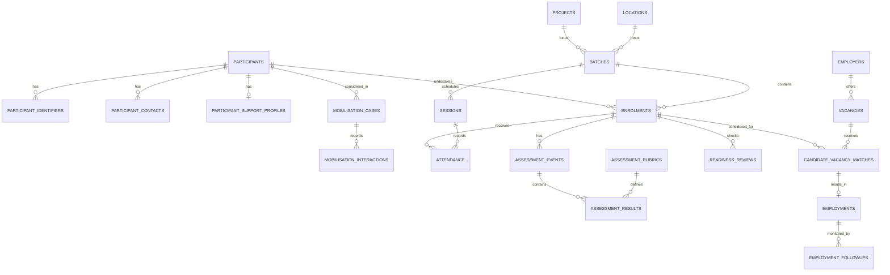

# Voice of Needy IDS canonical data model

**Status:** Version 2 proposal for analyst and senior-management review. No production schema or migration is authorised by this document.

## 1. Design result

This model is driven by VoN's 13 approved key questions and by the verified participant journey:

`mobilised → followed up → enrolled → trained → assessed → made placement-ready → mapped to a vacancy → joined employment → followed up at 12 and 24 months`

The proposed business data model contains **22 canonical tables**:

- 4 controlled reference/configuration tables;
- 18 operational tables;
- plus 2 platform staff/access tables and 5 isolated migration/audit tables that are not programme-domain entities.

This is deliberately smaller than the earlier proposal. It keeps repeatable events in separate tables, but it does not create a new table for every spreadsheet tab, status, document type or dashboard measure.

## 2. Rules used to decide whether a table exists

A table is retained only when at least one of these is true:

1. it represents a business object with its own lifecycle, such as a participant, batch, vacancy or employment;
2. it records a repeatable event, such as a mobilisation interaction, session, attendance mark, assessment or follow-up;
3. it resolves a genuine many-to-many relationship, such as candidates mapped to vacancies;
4. it needs separate privacy or access control, such as participant contacts and support needs;
5. it preserves migration provenance or an unresolved identity decision.

A field stays on its parent table when it is single-valued and has no independent workflow. This is why completion is held on `enrolments`, session status on `sessions`, readiness checks in one `readiness_reviews` table, and placement stages on `candidate_vacancy_matches`.

## 3. Layered architecture

| Layer | Purpose | Stored objects |
|---|---|---|
| Raw | Immutable copies or hashes of source rows | Outside core schema; access restricted |
| Staging | Typed, standardised source records and exceptions | Import-run-specific |
| Core | Authoritative operational records used by the frontend | 22 tables below |
| Audit | Provenance, identity review, data-quality issues and change history | 5 tables |
| Mart | Prepared, non-editable dashboard facts and dimensions | 7 facts + 4 dimensions |

The frontend writes only to approved core tables or controlled functions. Dashboards read only from mart views/tables.

## 4. Canonical tables

### 4.1 Controlled reference and configuration

| Table | Grain | Purpose |
|---|---|---|
| `ref.reference_values` | One option in one controlled list | Statuses, reasons, channels, assessment points, domains and other dropdown values without dozens of tiny lookup tables |
| `ref.projects` | One programme/project/donor agreement | Reporting context: programme, donor, dates, targets and active status |
| `ref.locations` | One centre, district, city or operational place | Standard centre and geographic reporting; optional parent hierarchy |
| `ref.assessment_rubrics` | One scored domain in one rubric version | Keeps baseline/midline/endline scores comparable and preserves historical rubric meaning |

### 4.2 Participant and mobilisation

| Table | Grain | Purpose |
|---|---|---|
| `core.participants` | One real person | Stable participant identity and basic profile; never duplicated for a new year, batch or project |
| `core.participant_identifiers` | One identifier per participant and identifier type | VoN ID, UDID and legacy/source IDs; supports controlled deduplication |
| `core.participant_contacts` | One contact method/person per participant | Verified mobile/email and caregiver contacts; restricted PII |
| `core.participant_support_profiles` | One current support profile per participant | Disability/support needs, work preferences, accessibility, location preference and longer-term goals; restricted |
| `core.mobilisation_cases` | One participant/prospect opportunity for one project cycle | Source, first contact, programme interest, current funnel outcome, denial/non-joining reason and conversion link |
| `core.mobilisation_interactions` | One call, visit, camp contact or follow-up | Complete follow-up history, staff owner, outcome and next action |

`mobilisation_cases.participant_id` may be null while a prospect is unresolved. Conversion creates or links one participant and later one enrolment. Names alone never trigger a merge.

### 4.3 Training delivery

| Table | Grain | Purpose |
|---|---|---|
| `core.batches` | One delivery cohort | Project, centre, dates, planned intake, capacity and batch status |
| `core.enrolments` | One participant stay in one batch | Registration/enrolment, exit, completion, dropout and re-entry outcome |
| `core.sessions` | One planned session for one batch | Module, plan/actual date, status, reschedule/cancellation reason and facilitator |
| `core.attendance` | One enrolment in one session | Present/absent/late/leave status and reason; unique per enrolment-session |
| `core.assessment_events` | One assessment sitting for one enrolment at one assessment point | Baseline, midline or endline event, date, assessor and rubric version |
| `core.assessment_results` | One domain score within an assessment event | Raw score, maximum score, normalised percentage and missing reason |
| `core.readiness_reviews` | One dated readiness review for one enrolment | Profile completeness, document verification, resume status and interview readiness |

Completion is not a separate table because one enrolment has one current completion outcome. Changes remain traceable through the audit log.

### 4.4 Employer, placement and outcomes

| Table | Grain | Purpose |
|---|---|---|
| `core.employers` | One employer organisation | Employer identity, sector, accessibility notes, relationship status and last verified date |
| `core.vacancies` | One job opportunity | Employer, role, location, requirements, accessibility, openings and active dates |
| `core.candidate_vacancy_matches` | One enrolment mapped to one vacancy | Suitability checks and the referral/interview/offer/rejection pipeline |
| `core.employments` | One verified employment episode | Actual joining, role, employer, status, salary at joining, end date and verified evidence |
| `core.employment_followups` | One scheduled/actual checkpoint for one employment episode | 12/24-month retention, current employer/job, exit reason, income and verification status |

The match table is necessary because one candidate can be considered for several vacancies and one vacancy can receive several candidates. Employment is separate because a referral or offer is not proof of joining.

### 4.5 Platform staff and access (outside the 22 business tables)

| Table | Grain | Purpose |
|---|---|---|
| `core.staff` | One staff member | Operational ownership and optional link to an authenticated user |
| `security.user_roles` | One user-role-scope assignment | Least-privilege access by role and, when required, project/centre |

Authentication users remain in the platform auth schema; participant records are never authentication users by default.

## 5. Core relationships

## 6. Business keys and constraints

| Object | Internal PK | Important uniqueness rule |
|---|---|---|
| Participant | UUID | No natural-key auto-merge; identifiers unique only where verified and applicable |
| Participant identifier | UUID | `(identifier_type, normalised_value)` unique for verified identifiers |
| Mobilisation case | UUID | Source record key unique within import; multiple cases per person allowed |
| Batch | UUID | Business batch code unique; code is not the database PK |
| Enrolment | UUID | Normally unique `(participant_id, batch_id)`; approved re-enrolment is a new row with explicit attempt number |
| Session | UUID | Unique `(batch_id, session_sequence)`; planned and actual dates remain separate |
| Attendance | UUID | Unique `(enrolment_id, session_id)` |
| Assessment event | UUID | Unique `(enrolment_id, assessment_point, attempt_number)` |
| Assessment result | UUID | Unique `(assessment_event_id, rubric_item_id)` |
| Vacancy match | UUID | Unique `(enrolment_id, vacancy_id, match_attempt)` |
| Follow-up | UUID | Unique `(employment_id, checkpoint_month, attempt_number)` |

Every table includes `created_at`, `updated_at` and, where relevant, `created_by` and `updated_by`. Historical source row numbers are lineage attributes, never primary keys.

## 7. Required state distinctions

The system must not collapse the following values into blank:

- unknown;
- not collected;
- not applicable;
- pending/not yet due;
- awaiting verification;
- unreachable;
- declined;
- failed validation.

Null means genuinely absent or not yet known according to the field definition. Controlled statuses capture the business meaning.

## 8. Tables deliberately not created

| Earlier concept | Decision | Reason |
|---|---|---|
| Referral table | Removed | Source/referral details belong to the mobilisation case unless referral organisations gain their own workflow |
| Mobilisation assignment table | Removed | Current owner and next action fit the case/interaction; history is in interactions and audit |
| Registration table | Combined with enrolment | Current sources do not prove a separate reusable registration lifecycle |
| Training completion table | Combined with enrolment | Completion is one outcome of an enrolment |
| Session definition + scheduled session | Combined as `sessions` | VoN key questions require the delivered schedule, not a separate reusable template yet |
| Document table | Combined as readiness review | KQ07 needs verification status, not document-file management |
| Placement attempt + stage event tables | Combined as vacancy match | Current funnel can be represented by current stage plus dated milestones; audit preserves changes |
| Follow-up schedule table | Combined with employment follow-up | Due date, checkpoint and completion belong to the same record |
| Income observation table | Combined with employment/follow-up | Only joining and checkpoint income are required at present |
| Support intervention table | Deferred | No approved key question or verified workflow yet |
| Separate donor table | Deferred | Donor attributes live on project until reuse and donor administration justify a table |

If later evidence shows a new independent lifecycle, the model can be extended through a reviewed migration without changing participant or enrolment identifiers.

## 9. Privacy boundaries

- Direct contact data and government identifiers are restricted fields.
- Support/disability information is accessible only to authorised operational roles.
- Dashboard participant dimensions use a pseudonymous reporting key and approved categories, not names, phone numbers, UDID or exact addresses.
- Service-role credentials never reach the frontend.
- Real participant data is never committed to GitHub.

## 10. Approval gate

Senior managers should approve the business journey, the meaning of statuses and the reporting questions. The analyst and technical reviewer should approve grains, keys, constraints and source mappings. Only after those approvals should SQL migrations be written or historical data loaded.
