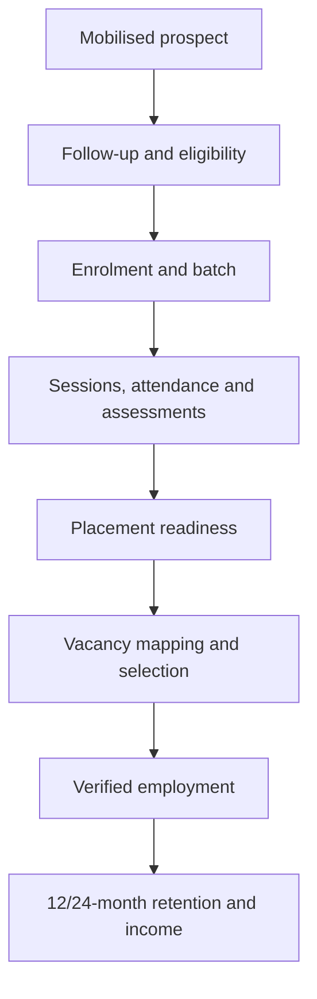

# Senior-management review pack: VoN data model version 2

## Decision requested

Approve the proposed representation of VoN's participant journey and the management definitions that must be finalised before technical implementation. This is approval of the business model, not approval to migrate production data.

## What changed from the first proposal

The model has been rebuilt against the 13 key questions and simplified to **22 canonical business-data tables**, plus minimal staff/access and audit structures. Tables were combined or removed where they did not have an independent business lifecycle. Historical import/audit tables and dashboard marts are now visibly separated from operational tables.

## Business journey represented

## What managers should review

| Area | Proposed rule | Approval needed |
|---|---|---|
| Mobilised denominator | Deduplicated eligible mobilisation cases within reporting period | Define eligibility and which sources count |
| Conversion | Enrolment, not registration or verbal interest | Confirm |
| Planned intake | Stored on each batch before enrolment starts | Confirm ownership and change approval |
| Session delivery | Planned, delivered, rescheduled and cancelled are distinct | Approve module and reason lists |
| Assessment coverage | Baseline/midline/endline calculated against eligible enrolments | Define eligibility and timing windows |
| 45-day completion | Stored as enrolment outcome, calculated using approved attendance rule | Approve exact rule |
| Placement readiness | Profile + verified documents + current resume + interview readiness | Approve evidence standard |
| Placement | Verified actual joining, not selection or offer | Confirm verification evidence |
| Suitability | Skills, preferences, location and accessibility assessed separately | Approve criteria and who signs off |
| Retention | Verified status at 12 and 24 months; unreachable/unverified shown separately | Approve denominator treatment |
| Income improvement | Comparable verified joining and checkpoint income | Approve collection method and privacy access |

## Why the main separations are necessary

- A participant is a person; an enrolment is one stay in one batch. A person can return without being duplicated.
- A planned session is distinct from an attendance mark. One session serves many enrolments.
- An assessment event is distinct from its domain scores, allowing several domains under one sitting.
- A vacancy mapping is not an employment. Selection and offers can fail to produce joining.
- Employment follow-ups repeat at checkpoints and must preserve unreachable/unverified outcomes.
- Contacts, identifiers and disability/support needs are separated for privacy and access control.

## What has deliberately not been modelled

Fees, goal plans, generic meeting logs, monthly staff targets and other entities in the external reference model were excluded because VoN's current key questions and evidence do not require them. Donor is currently an attribute of a project rather than a separate master table. These can be added later only with verified need.

## Data gaps that affect the dashboard

1. Standard non-enrolment and dropout reasons are incomplete.
2. Planned intake and planned sessions are not consistently structured historically.
3. Employer vacancy and candidate mapping data need a formal workflow.
4. Readiness requires one agreed checklist.
5. Assessment rubrics/domains must be versioned and comparable.
6. Verified joining must be distinguished from offers.
7. 12/24-month follow-up requires a scheduled process.
8. KQ12 income data is currently unavailable and requires new collection.

## Approval options

| Option | Consequence |
|---|---|
| Approve version 2 with definitions | Technical team can create the physical schema/migrations after formal Checkpoint 3 sign-off |
| Approve with named amendments | Model is revised and re-presented; no production work starts |
| Defer | Discovery continues; frontend must not lock incompatible forms/contracts |

## Recommended approval sequence

1. VoN programme managers validate the journey and status definitions.
2. Goalkeep analyst validates KQ formulas, grains, historical availability and gaps.
3. Frontend lead validates form/workflow compatibility.
4. Technical reviewer validates keys, constraints, privacy boundaries and RLS plan.
5. Design is marked approved with decision date and approvers.

Do not merge the model as an approved production design or create production schema objects until this review is completed.
